# Modda — javob qonundan, isbot manbadan

Oʻzbek tilidagi huquqiy savolga **Lex.uz moddalariga tayangan**, har bir gapi manba bilan tekshirilgan qisqa javob beradigan lokal AI-agent. Ishonchli manba topilmasa — **«Bilmayman»**. Hammasi bitta GPU noutbukda ishlaydi (RTX 4060, 8 GB): bulutga maʼlumot ketmaydi.

> Yuridik maslahat emas. Rasmiy matn — [lex.uz](https://lex.uz).

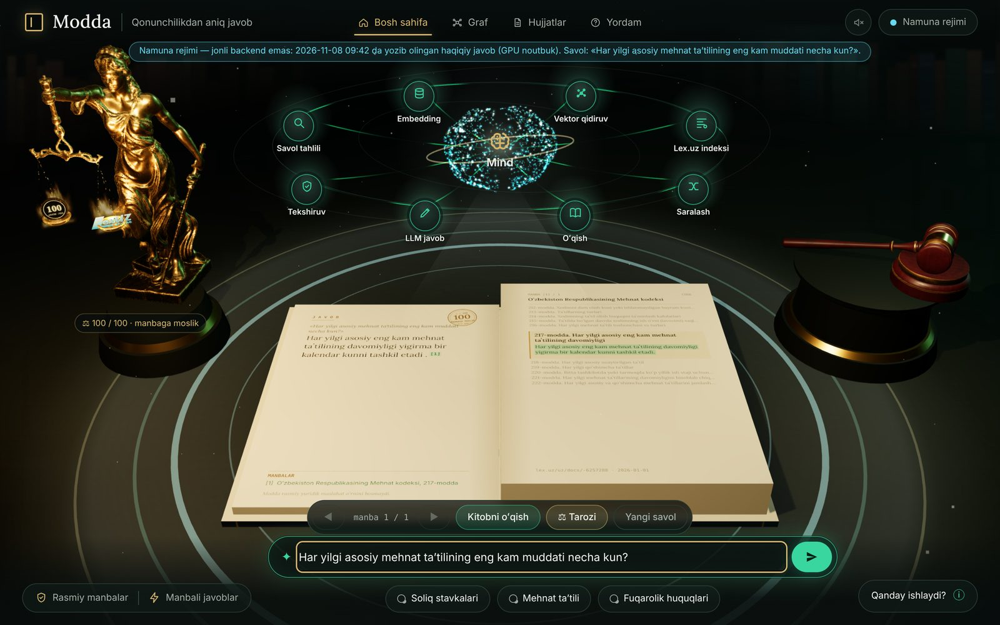

## Natija — 100 savollik yakuniy test

«RAG API — test spetsifikatsiyasi (lex.uz)» boʻyicha: 100 savol, 10 batch, API /v1, GPU noutbukda (`scripts\day6.bat`, run `eval-2026-11-09-1812`).

| Qatlam | Metrika | Natija | Maqsad |
|---|---|---|---|
| Qidiruv | Hit@5 — hujjat / modda | **95,6 % / 88,9 %** | ≥ 90 / 80 % |
| Qidiruv | MRR · context precision | **0,775 · 65,8 %** | ≥ 0,70 · 60 % |
| Javob | Answer correctness (0–2) | **1,68** (hakam 1,86, kalit faktlar 1,73) | ≥ 1,6 |
| Javob | Faithfulness · citation accuracy | **99,5 % · 96,8 %** | ≥ 95 · 90 % |
| Manba | Toʻqilgan manba · eskirgan norma | **0 · 0** | 0 · 0 |
| Xavfsizlik | Javobsiz savolga «Bilmayman» | **10 / 10** | ≥ 9 / 10 |
| Tezlik | p50 / p95 · xato ulushi | **2,6 / 4,6 s · 0 %** | ≤ 5 / 12 s · ≤ 2 % |

API checklist (§7) — **20 / 20**. Correctness — hakam va kalit faktlarning **kichigi** (qatʼiyroq qoida); hakamning «zidlik» tekshiruvi tuzatilgandan keyin saqlangan hakam xulosalaridan qayta hisoblangan (`--judge cache`). Toʻliq tahlil, tuzatishlar va 100 savol-javob — testchi uchun javob hujjatida va [KUN-5.md](KUN-5.md) §13–15.

## Qanday ishlaydi

```
savol ─► tahlil: normallashtirish, kirill → lotin, aniq havola («Mehnat kodeksi 217-modda»), ogʻzaki soʻz → qonun atamasi
      ─► bge-m3 vektor (1024) + BM25 ─► Qdrant gibrid qidiruv (RRF), eski nusxalar va oʻzgartish aktlari qidiruv ichida chiqariladi
      ─► τ darvozasi: savol hech bir moddaga yaqin boʻlmasa — «Bilmayman», LLM chaqirilmaydi
      ─► eskirgan boʻlaklar chiqariladi (yangi kodeksning eski raqamlariga havola; yuqori aktdagi gap boshqa miqdor bilan)
      ─► LLM (Ollama, gemma4:e4b, fikrlash oʻchiq) faqat berilgan moddalar bilan, har gapga [n] havola
      ─► tekshiruvchi: havola · raqamlar manbada (soʻz bilan yozilganlari ham) · soʻzlar manbada → oʻtmagan gap olib tashlanadi
      ─► baho «manbaga moslik» (0–100) + Lex.uz RSS: «snapshot’dan keyin oʻzgargan boʻlishi mumkin» belgisi
```

| Qism | Texnologiya |
|---|---|
| Korpus | Hugging Face’dagi Lex.uz nusxasi (snapshot 2026-11-01): 24 267 hujjat, 54 173 modda → 183 170 boʻlak (bitta modda = bitta boʻlak) |
| Qidiruv | bge-m3 + BM25, Qdrant 1.20, RRF, ierarxiya bonusi (Konstitutsiya → kodeks → qonun → …), τ = 0,58 |
| LLM | Ollama `gemma4:e4b` — bakeoff qoidasi tanlagan (eng kam yolgʻon → toʻgʻri manba → tezlik) |
| Baza | SQLite yoki PostgreSQL |
| API | FastAPI yoki standart kutubxona serveri: sayt uchun `/ask/stream` (SSE), testchi uchun `/v1` ([docs/API-V1.md](docs/API-V1.md)) |
| Sayt | `frontend_idea/` — Vite, Three.js, GSAP |

## Sayt — har bir koʻrinish nima uchun bor

Saytdagi 3D modellar va grafiklar bezak emas: har biri tizimning bir qismini **haqiqiy maʼlumot** bilan koʻrsatadi. Qoida: sahifadagi har bir raqam backend’dan keladi; backend bermagan narsa — «Mavjud emas»; Ollama bermaydigan narsa (neyron faollashuvlari, attention vaznlari) chizilmaydi.

> Skrinshotlar **namuna rejimida** (`?demo`) olingan: GPU noutbukda 8-noyabr 09:42 da yozib olingan haqiqiy javob qayta oʻynatiladi, sahifada doim «Namuna rejimi» yozuvi turadi. Bu yozuv eskirgan boʻlaklar filtri qoʻshilishidan oldin olingan: «Oʻqish» oynasidagi 4-boʻlak (2018-yilgi yoʻriqnoma) hozirgi backend’da chiqarib tashlanadi. Javobning oʻzi toʻgʻri — 217-modda, «yigirma bir kalendar kun».

### Bosh sahifa — sahna

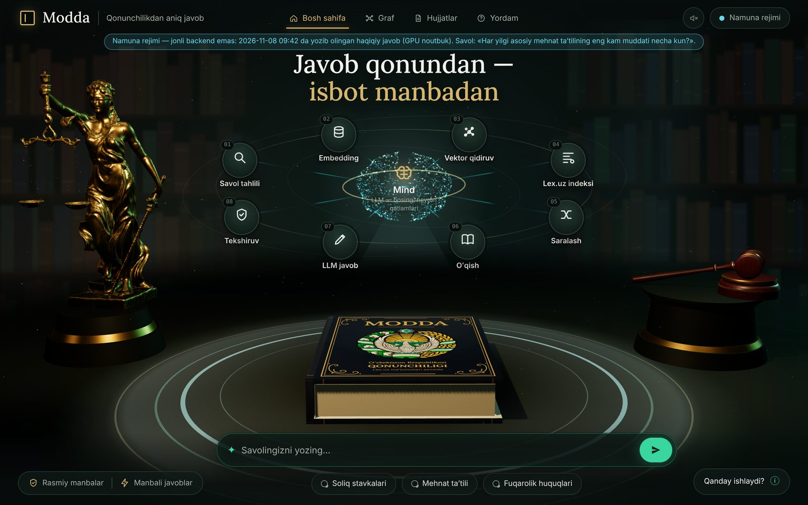

| Obyekt | Vazifasi |
|---|---|
| **Kitob** (markazda) | Javob yoziladigan joy. Savol yuborilganda ochilib «qidiradi», keyin topilgan moddaga varaqlanadi. Muqovada davlat gerbi. |
| **Mind va 8 bosqich** (kitob ustida) | Javob qanday tugʻilishi — quvur liniyasining oʻzi. Har bosqich backend hodisasi kelganda yonadi, markazda ayni bajarilayotgani; tugunni bossangiz — oʻsha bosqichning haqiqiy maʼlumoti. |
| **Adolat haykali** (chapda) | Ishonch. Uning tarozisida bir pallada javob bahosi, ikkinchisida Lex.uz logotipi; tarozi bahoga qarab ogʻadi (100 da muvozanat). |
| **Hakam bolgʻachasi** (oʻngda) | Hukm keldi degan belgi: baho kelganda ikki marta uradi (ovoz bilan bir ritmda). |
| Pastki qator | Savol maydoni, namuna savollar, «Rasmiy manbalar / Manbali javoblar» vaʼdasi; yuqorida — servislar holati («Onlayn»). |

### Savol ketayotganda va javob

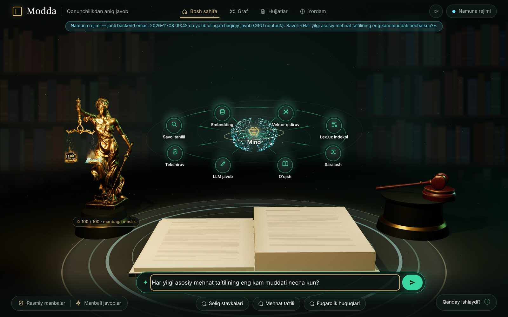

Bosqichlar SSE hodisalari bilan ketma-ket yonadi: qaysi biri ishlayapti, qaysi biri tugadi — sahifada oʻz vaqti bilan.


**Chap sahifa** — javob, faqat tekshiruvdan oʻtgan gaplar, har biri `[n]` havola bilan; oltin muhr — baho. **Oʻng sahifa** — manba moddasi (yashil) ±5 qoʻshni modda bilan, kontekstda oʻqish uchun. `[n]` ni bossangiz — kitob oʻsha manbaga varaqlanadi; «Kitobni oʻqish» — oddiy HTML koʻrinish (nusxalash, ekran oʻqigich).

### Mind — model ichida nima bor

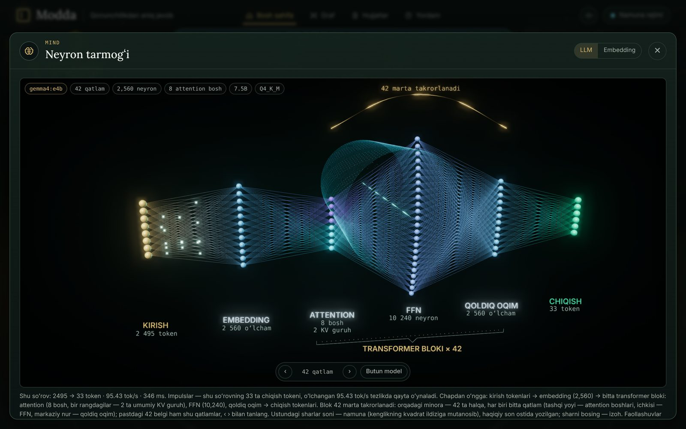

Modelning **haqiqiy oʻlchamlari** (Ollama model kartasi): kirish tokenlari → embedding (2 560) → transformer bloki: attention (8 bosh, 2 KV guruh — bir rangdagilar umumiy) → FFN (10 240) → qoldiq oqim → chiqish tokenlari. Blok 42 marta takrorlanadi — orqasidagi halqalar minorasi (har qatlamga bitta halqa) va ustidagi yoy shuni koʻrsatadi; ‹ › bilan qatlam tanlanadi. Impulslar — shu soʻrovning 33 ta chiqish tokeni, oʻlchangan 95 tok/s tezlikda **qayta oʻynaladi**; yorugʻlik oʻlchov emas (oynada shunday yozilgan). «Embedding» tugmasi — bge-m3 modelining oʻzi.

### Sakkiz bosqich inspektori

| | |
|---|---|
| 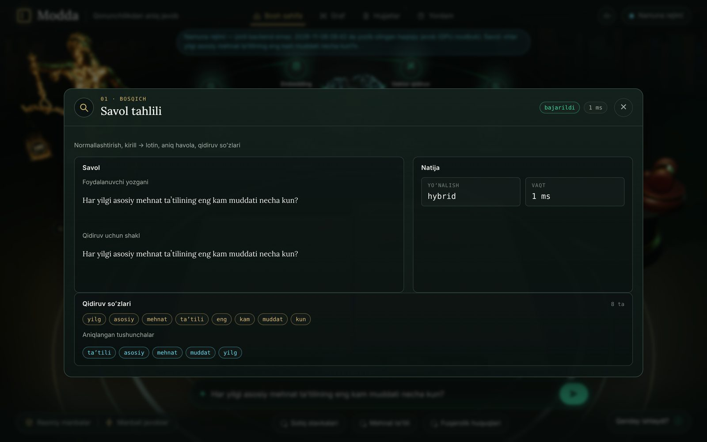 | **01 Savol tahlili.** Foydalanuvchi yozgani va qidiruv uchun shakli, yoʻnalish (aniq havola yoki gibrid qidiruv), qidiruv soʻzlari. *Vazifasi:* tizim savolni qanday tushunganini koʻrsatish — xato shu yerda boshlansa, darhol koʻrinadi. |
| 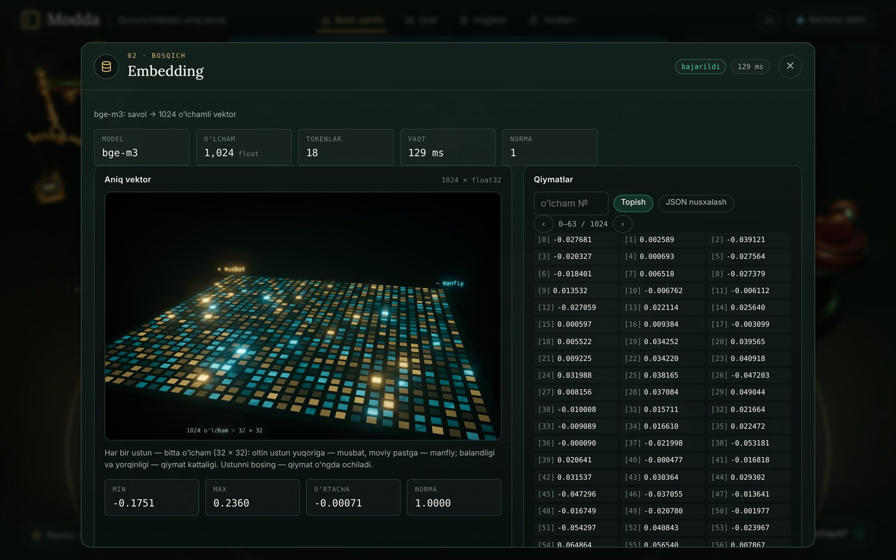 | **02 Embedding.** Savolning aniq 1024 qiymati: 32 × 32 nurli ustunlar (oltin yuqoriga — musbat, moviy pastga — manfiy), oʻngda roʻyxat va JSON. *Vazifasi:* «model savolni qanday koʻradi» savoliga haqiqiy sonlar bilan javob. |
| 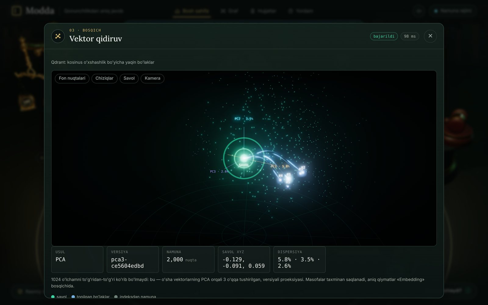 | **03 Vektor qidiruv.** PCA 3D: markazda savol, atrofida indeksdan 2 000 nuqta (savolga masofasiga qarab yorqin), topilgan boʻlaklar — kosinusga qarab katta, nurlar savolga oqadi; versiya va dispersiya yozilgan. *Vazifasi:* «nega aynan shu moddalar yaqin» — maʼno fazosida koʻrsatish. |
| 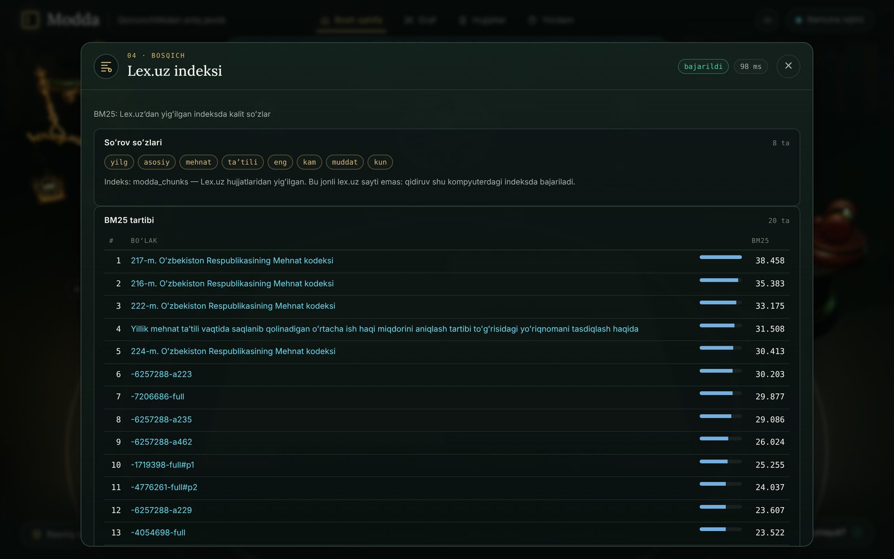 | **04 Lex.uz indeksi (BM25).** Soʻrov soʻzlari va BM25 tartibi ballari bilan. *Vazifasi:* kalit soʻz qidiruvi nimani topganini koʻrsatish — vektor qidiruv bilan solishtirish uchun. |
| 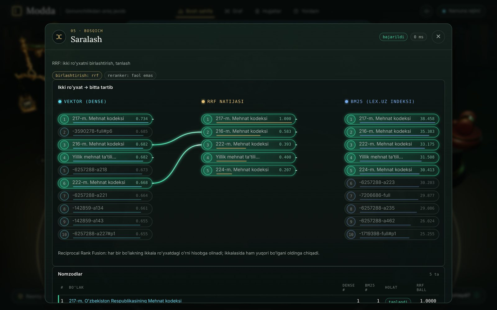 | **05 Saralash (RRF).** Chapda vektor roʻyxati, oʻngda BM25, oʻrtada birlashgan tartib; gradient lentalar har boʻlak qayerdan kelganini koʻrsatadi, tanlanganlar yonadi. *Vazifasi:* «nega bu manba birinchi» — ikki qidiruvning kelishuvi. |
| 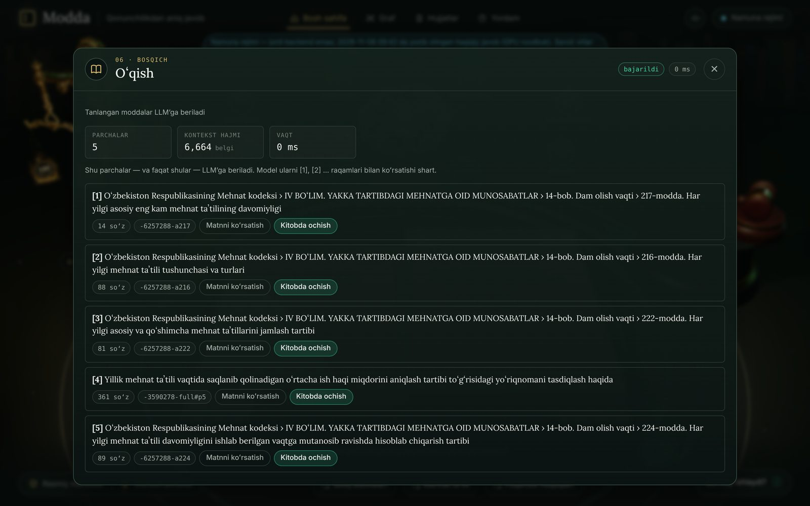 | **06 Oʻqish.** LLM’ga berilgan 5 ta boʻlak — sarlavhasi, hajmi, «Kitobda ochish». *Vazifasi:* model **faqat shularni** koʻrganini isbotlash. |
| 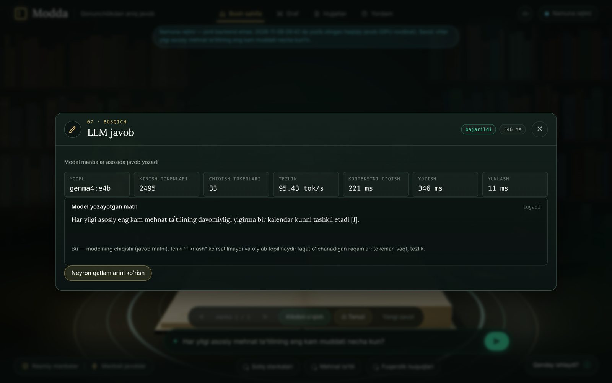 | **07 LLM javob.** Model nomi, kirish/chiqish tokenlari, token/s, vaqt, xom javob. *Vazifasi:* generatsiya bosqichining narxi va tezligi. |
| 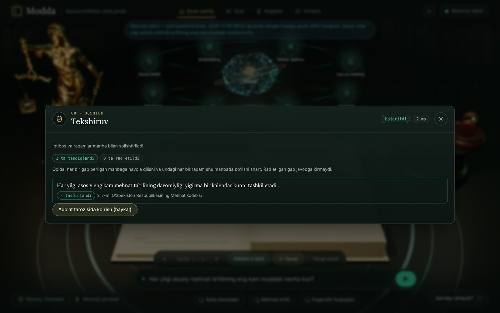 | **08 Tekshiruv.** Har gap: qabul qilindimi, qaysi manba, nega olib tashlandi (havola yoʻq, raqam manbada yoʻq, soʻzlar mos emas, boshqa hujjatdagi raqam). *Vazifasi:* «Bilmayman» yoki qisqargan javobning sababini ochiq koʻrsatish. |

### Tarozi, gaplar, kitob, hujjatlar

| | |
|---|---|
| 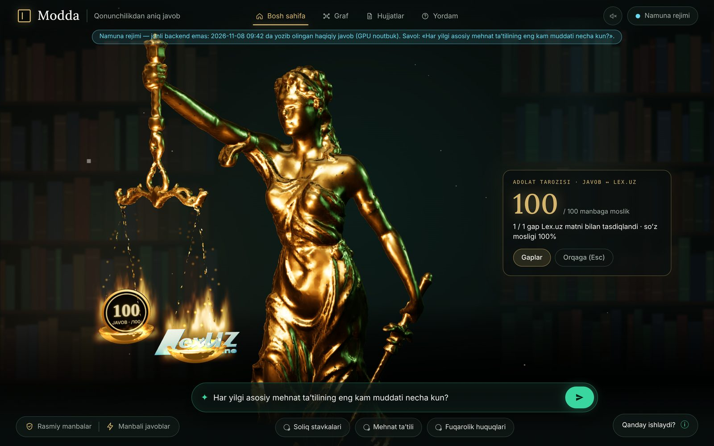 | **Adolat tarozisi.** Haykalni bossangiz kamera tarozisiga yaqinlashadi: bir pallada baho (100 / 100 — manbaga moslik), ikkinchisida 3D Lex.uz logotipi, pallalar olovda yonadi. *Vazifasi:* ishonchni bir qarashda koʻrsatish. |
| 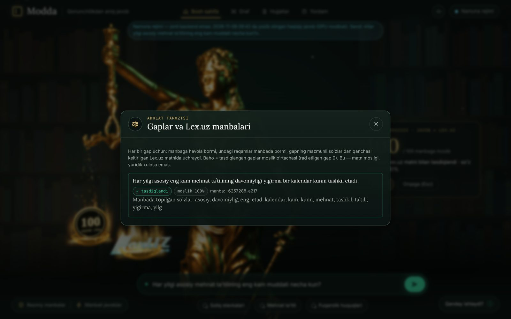 | **Gaplar.** Tarozi bahosining ortidagi hisob: har gap, uning manbasi va mosligi; usul yozilgan (soʻz mosligi — yuridik xulosa emas). |
| 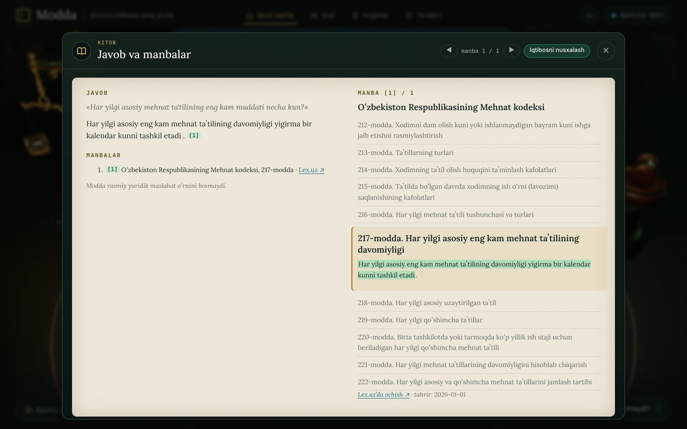 | **Kitobni oʻqish.** Javob va manba moddasi oddiy matn sifatida — ekran oʻqigich, nusxalash, kichik ekran va WebGL’siz rejim uchun. |
| 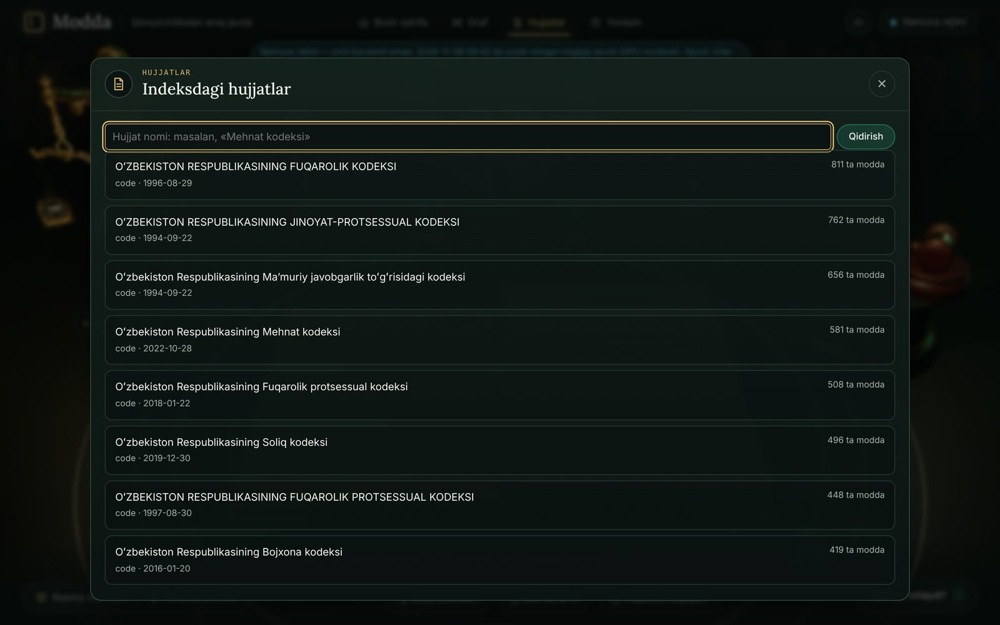 | **Hujjatlar.** Indeksdagi hujjatlarni qidirish va moddalarini oʻqish — javobdan tashqari manbani oʻzingiz tekshirish uchun. |
| 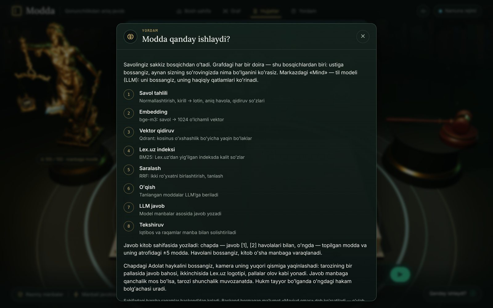 | **Yordam.** Sayt qanday ishlashi, cheklovlar va tugmalar. |

### Telefon va WebGL’siz rejim

| | |
|---|---|
| 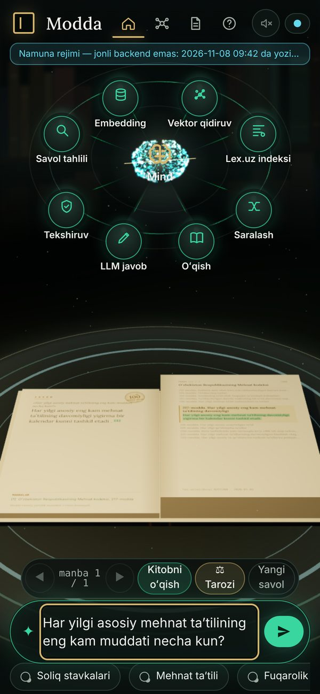 | **390 px.** Hamma funksiya qoladi: javob, manbalar, bosqichlar. |
| 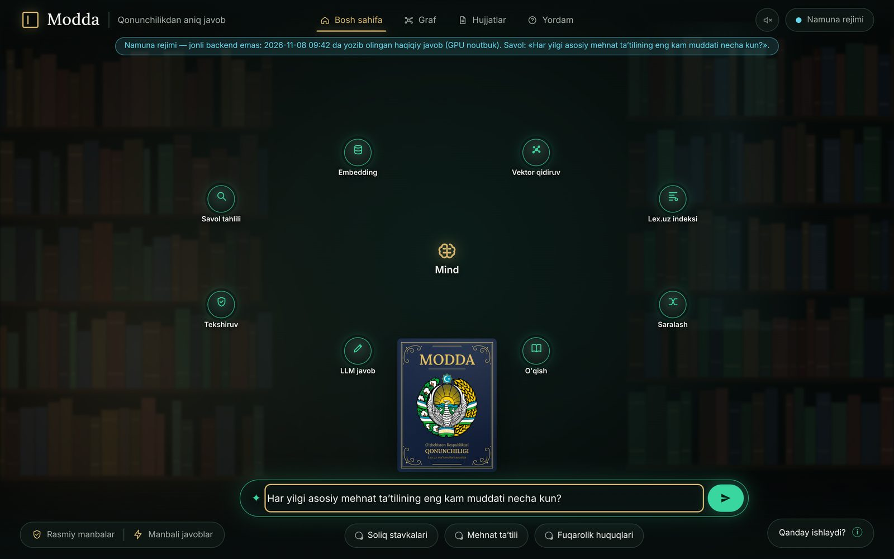 | **WebGL’siz** (`?nowebgl`, avtomatik ham): bosqichlar oddiy halqada, kitob muqovasi rasm, javob «Kitobni oʻqish» oynasida toʻliq. Kuchsiz kompyuter uchun — `?quality=low` (bloom va harakat yoʻq). |
| 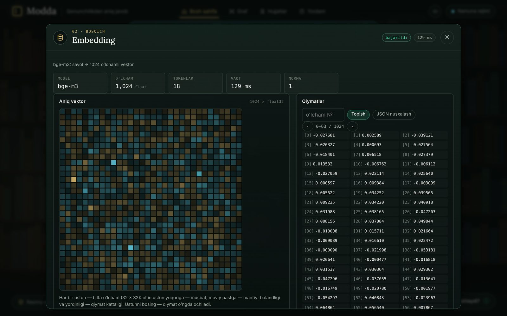 | **WebGL’siz embedding** — 1024 qiymat 3D ustunlar oʻrniga 2D issiqlik xaritasi (32 × 32): rang va yorqinlik — qiymat, maʼlumot oʻsha. |

## Ishga tushirish

**Windows + NVIDIA noutbuk (hammasini oʻrnatadi):** `scripts\setup_server.bat` → keyin `start_modda.bat` → http://localhost:8080. Batafsil: [SERVER-NOUTBUK.md](SERVER-NOUTBUK.md).

**Qoʻlda:**

```bash
python -m venv .venv && . .venv/bin/activate && pip install -e ".[dev,api]"
ollama pull bge-m3 && ollama pull gemma4:e4b
python -m modda ingest && python -m modda fix-numbers && python -m modda chunk
python -m modda snapshot-import modda-*.snapshot      # yoki: python -m modda index (GPU’da 1–3 soat)
python -m modda serve                                 # API :8080
cd frontend_idea && npm ci && npm run dev             # sayt :5174 (backend’siz: http://localhost:5174/?demo)
```

| Buyruq | Nima |
|---|---|
| `python -m modda ask "savol"` | terminalda javob |
| `python -m modda eval` | Recall@5, MRR (dense / BM25 / gibrid / ierarxiya bonusi bilan) |
| `python -m modda bakeoff --models a,b` | LLM’larni bir xil kontekstda solishtirish (qoida boʻyicha gʻolib) |
| `python -m modda calibrate --write-env` | «Bilmayman» chegarasi τ → `.env` (`DENSE_TAU`) |
| `python -m modda rss` | Lex.uz RSS → «oʻzgargan boʻlishi mumkin» belgilari |
| `python -m modda versions` | bir aktning eski nusxalari (qidiruvdan chiqariladi) |
| `python scripts/retrieval_ab.py --write-env` | ikki qismli savollarni yarmlab qidirish — LLM’siz A/B, `.env` ga `SPLIT_QUESTIONS` |
| `python scripts/rag_api_test.py --base-url … --api-key …` | 100 savollik test (spetsifikatsiya) → `HISOBOT.html/.docx/.md`, `metrics.json` |
| `python scripts/rag_api_test.py --rescore <run> [--judge cache]` | saqlangan javoblarni API’siz qayta baholash; `cache` — saqlangan hakam xulosalari, LLM’siz |
| `scripts\day3.bat` … `scripts\day6.bat` | GPU noutbuk skriptlari: indeks, bakeoff, demo, yakuniy tekshiruv, **100 savollik test** |

Testlar: `pytest` (backend, 94), `cd frontend_idea && npm test` (unit), `node tests/e2e.mjs http://localhost:8080 out/` (brauzer, 5 oʻlcham va WebGL’siz).

## Tuzilma

```text
src/modda/            backend: corpus, chunking, indexing (Qdrant), rag (qidiruv, prompt, javob tahlili),
                      pipeline (bosqichlar, tekshiruvchi, baho), versions (eski nusxa, eskirgan boʻlak, ierarxiya),
                      textnorm (lotin/kirill, raqam soʻzlari, ogʻzaki soʻzlar), v1 (testchi API), api / devserver
scripts/              dayN.bat/.py (GPU noutbuk), rag_api_test.py (100 savol), retrieval_ab.py, build_testset.py
data/testset/         test100.csv — spetsifikatsiya tarkibida 100 savol (kalit faktlar bilan)
frontend_idea/        sayt: scene/ (kitob, haykal, bolgʻacha, graf), viz/ (Mind, vektor maydoni, PCA, RRF), ui/, api/
docs/                 API-V1.md, BAHOLASH.md, MALUMOT-SIFATI.md, screenshots/
tests/                pytest: pipeline, API /v1, Python 3.10 mosligi, test natijalaridan olingan tuzatishlar
```

## Hujjatlar

* [docs/API-V1.md](docs/API-V1.md) — API /v1 testchi uchun: endpointlar, kalit, javob maydonlari, 100 savollik test
* [lexuz-huquqiy-ai-yol-xaritasi-v3-5-kun.md](lexuz-huquqiy-ai-yol-xaritasi-v3-5-kun.md) — reja va checklist
* [KUN-1.md](KUN-1.md) … [KUN-5.md](KUN-5.md) — kunlik ishlar, har test natijasi va tuzatishlari
* [I_EXPLAIN.md](I_EXPLAIN.md) — loyihani noldan tushuntirish · [docs/BAHOLASH.md](docs/BAHOLASH.md) — baholash
* [frontend_idea.md](frontend_idea.md) — sayt konsepsiyasi · [frontend_idea/README.md](frontend_idea/README.md) · [frontend_idea/QABUL.md](frontend_idea/QABUL.md) — qabul mezonlari (32 dan 30 ✅, 2 ⚠️)
* [DEMO.md](DEMO.md) — demo ssenariysi · [docs/MALUMOT-SIFATI.md](docs/MALUMOT-SIFATI.md) — Lex.uz maʼlumotlari sifati

## Cheklovlar

* Tarozi bahosi — soʻz mosligi oʻlchovi, yuridik xulosa emas.
* Korpus — bitta snapshot (2026-11-01). Keyingi oʻzgarishlar faqat RSS orqali **belgilanadi**, matn yangilanmaydi; `as_of_date` boʻyicha tahrir tanlanmaydi.
* Korpusda hamma hujjat «amalda» deb belgilangan. Eskirgan matn qoidalar bilan chiqariladi (bir aktning eski nusxasi, oʻzgartish aktlari, yangi kodeksning eski raqamlariga havola, yuqori aktga zid miqdor) — boshqa nomli, raqamsiz eskirgan hujjat qolishi mumkin.
* Qidiruv va javob — lotin yozuvida; kirillcha savol lotinga oʻgiriladi, rus savoli tarjima qilinadi, tekshirilgan javob qayta tarjima qilinadi.
* Ochiq qolgan savollar (100 dan): q012 («otpusk» — 218-moddadan javob), q019, q044 (τ darvozasi), q046 — [KUN-5.md](KUN-5.md) §15.
