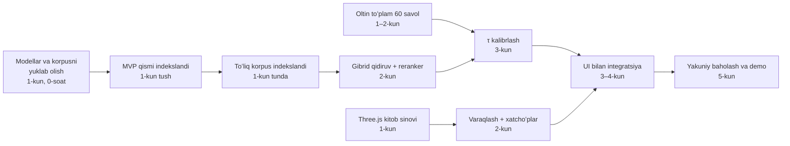
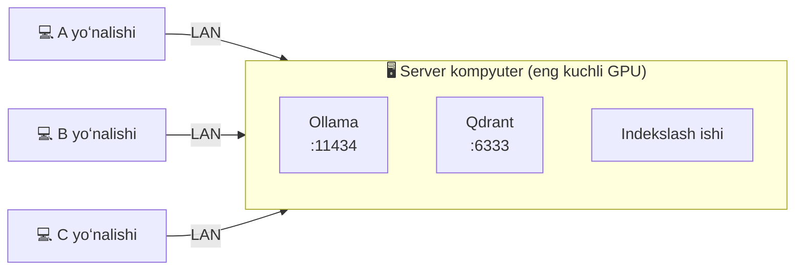
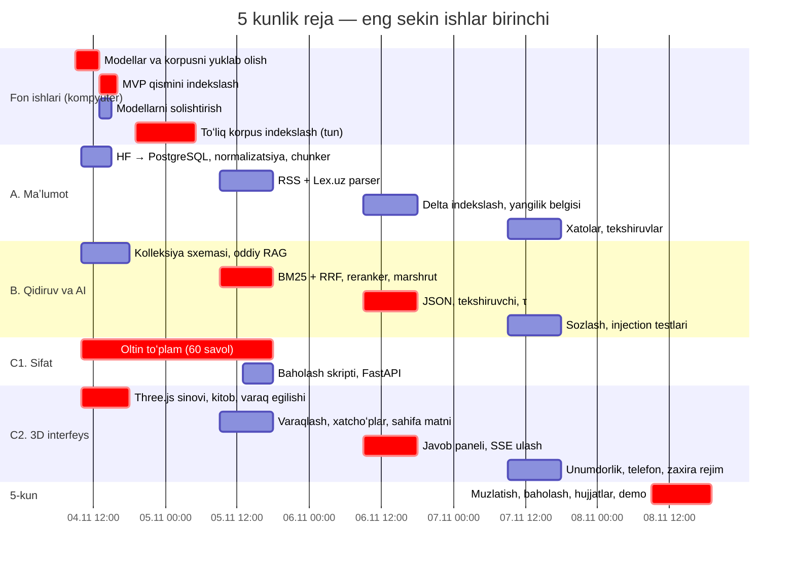
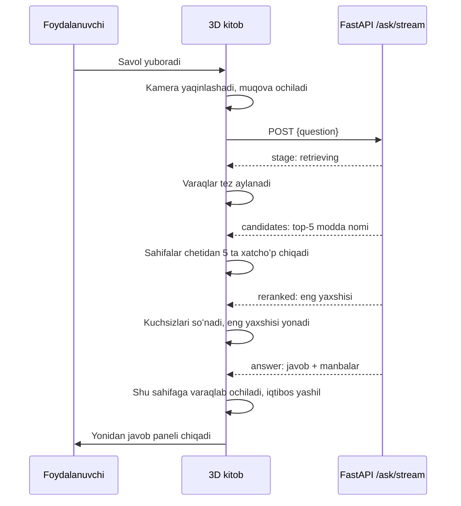

# Lex.uz Huquqiy AI-agent — 5 kunlik reja (v3)

> **Vaziyat:** butun loyihani qurish uchun **5 kun** bor. Bu hujjat [v2 yoʻl xaritasini](lexuz-huquqiy-ai-yol-xaritasi-v2.md) shu muddatga moslaydi. v2 — toʻliq tizimning **uzoq muddatli rejasi** sifatida qoladi; bu fayl — **hozir nima va qaysi tartibda** qilinishini belgilaydi.
>
> **Asosiy tamoyil:** eng **sekin** va eng **katta** qadamlar birinchi boshlanadi. Kompyuter oʻzi ishlaydigan uzoq ishlar (yuklab olish, indekslash, modellarni sinash) — **1-kunning birinchi soatida**, odam vaqtini koʻp oladigan ishlar (test savollari) — **1-kundan**. Interfeysdagi eng katta va xavfli ish — **Three.js kitobi** — ham **1-kundan** boshlanadi; uni backend’ga ulash — 3-kunda.

Tushunchalar va vositalar jamoa uchun [I_EXPLAIN.md](I_EXPLAIN.md) da tushuntirilgan.

---

## 0. Holat: tekshiruv roʻyxati

> Har bir qadam tugaganda shu roʻyxat yangilanadi. Belgilar: ✅ bajarildi · 🔄 jarayonda · ⏸️ toʻxtatilgan · ↪️ boshqa yoʻl bilan · ❌ toʻsiq · ⬜ hali boshlanmagan. Batafsil buyruqlar — [KUN-1.md](KUN-1.md).
>
> **Oxirgi yangilanish:** 2026-11-08 16:40 (5-kun). `day5` (15:12, zaryadlovchida): 6/6 demo savol, sayt 60 kadr/s. `day6` (15:15) **test boshlanmadi** — server noutbukdagi Python 3.10 da yiqildi (3.12+ f-string sintaksisi); tuzatildi, endi 3.10 testi va day6 da kompilyatsiya tekshiruvi bor. Mind v5: tarmoq + 42 halqali minora. Qolgani: **(1) jamoadosh — `git pull` → `scripts\day6.bat` qayta**; **(2) Bobur — mahalliy shriftlar**; **(3) mashq**. Bajarilish: **92/93 qator, 46/47 belgi ≈ 99 %**.

### 1-kun — uzoq ishlar va asos

| Holat | Qadam | Natija / izoh |
|---|---|---|
| ✅ | HF korpusi yuklandi | articles + documents (Parquet, 321 MB) |
| ✅ | Modellar: `bge-m3`, `qwen3:8b`, `gemma4:e4b`, Llama-3.1-8B-Uz | hammasi yuklangan |
| ✅ | Reranker fayllari (`bge-reranker-v2-m3`) | HF keshida; `sentence-transformers` — 2-kunda |
| ✅ | Qdrant v1.20.0 | ishlayapti, kolleksiya hali yoʻq |
| ✅ | PostgreSQL 17 (`modda-pg`, port **5434**) | 5433 band edi — 5434 ga oʻtkazildi |
| ✅ | Korpus → PostgreSQL (`ingest`, `chunk`) | **54 173** qator, **183 170** boʻlak, MVP: **12 269** boʻlak |
| ✅ | Loyiha kodi: normalizatsiya, chunker, BM25, Qdrant REST, oddiy RAG, baholash, solishtirish | 26 test (SQLite va PostgreSQL 16 da) |
| ✅ | **Oltin toʻplam: 60 savol** (45 ta javobi bor, 15 ta yoʻq) | `data/golden/golden.jsonl`; 14 hujjat, 6 toifa; har bir kutilgan modda korpusda tekshirildi |
| ✅ | 10 ta Lex.uz sahifasi | `tests/fixtures/lexuz/` (Crawl-delay 20 s) |
| ✅ | 3D kitob (`web/`): ochilish, varaqlash, sahifaga ochilish, javob paneli, gerbli muqova | brauzerda barcha holatlar tekshirildi |
| ✅ | Sayt: namuna savollar olib tashlandi, sarlavha qisqartirildi | «Qonunchilikdan aniq javob» |
| ✅ | Ollama qayta oʻrnatildi (v0.40.14), embedding ishlaydi | |
| ✅ | Qolgan qadamlar bitta skriptda: `bash scripts/finish_day1.sh --full` | qisman indeksda `eval`/`bakeoff` faqat indekslangan savollarni hisoblaydi (26 test) |
| ✅ | `bench-embed`: **0,22 boʻlak/s** (CPU) → MVP ≈ 15 soat (bench), amalda 0,5 boʻlak/s ≈ 4,5 soat; butun korpus ≈ 233 soat | rejani oʻzgartirdi (2-kun) |
| ↪️ | MVP qismini indekslash (`index --mvp`, 12 269 boʻlak) | 4 896 tasi CPU’da qilindi, keyin toʻxtatildi; **hammasi GPU snapshot’ida bor** |
| ✅ | Birinchi savol (`ask`) | 6-noyabr: sayt orqali `/ask/stream` → 200 (API logi) |
| ↪️ | Modellarni solishtirish (`bakeoff`, 20 savol) → LLM tanlash | CPU’da juda sekin → **GPU noutbukda bajarildi**: gemma4:e4b tanlandi (4-kun boʻlimi) |
| ↪️ | 3D kitob kadr/s — oʻz kompyuterda ≥ 45 | Iris Xe’da 27 → demo **GPU noutbukda** (RTX 4060: median 60, eng past 53) |
| ✅ | Tungi indekslash | oʻrniga GPU kompyuterda toʻliq indeks yasaldi (2-kun boʻlimi) |

### 2-kun — toʻliq qidiruv

> **Rejadagi oʻzgarish (1-kun, 14:14):** `bench-embed` — 0,22 boʻlak/s (GPU yoʻq, bge-m3 CPU’da). Butun korpus dense uchun ≈ 233 soat. Yechim — **ikki qatlamli indeks**: BM25 hamma 183 170 boʻlakka (daqiqalar), bge-m3 faqat kodeks, Konstitutsiya va qonunlarga (≈ 39 ming boʻlak). Batafsil: [KUN-2.md](KUN-2.md).

| Holat | Qadam | Izoh |
|---|---|---|
| ↪️ | MVP dense indeks (12 269 boʻlak) | GPU snapshot’ida — 12 269 tasining hammasi |
| ✅ | Ikki qatlamli indeks: `index --sparse-only`, standart `index` = BM25 hammaga + dense qonunlarga | kod tayyor, test qilingan |
| ↪️ | BM25 — butun korpus | snapshot’da hamma 183 170 boʻlakda BM25 bor — alohida ishga tushirish **shart emas** |
| ↪️ | Qonunlar dense (≈ 27 ming boʻlak) | snapshot’da — kodeks, qonun, qaror, farmon: hammasi dense |
| ✅ | **GPU kompyuter uchun bitta skript**: `scripts\setup_windows.bat` / `setup_windows.py` | Python, Ollama, HF CLI, Qdrant ni oʻzi oʻrnatadi; har bosqichda zaxira usul; vaqtlar va log; qolgan joydan davom etadi. Soxta Ollama + haqiqiy Qdrant 1.20 bilan boshidan oxirigacha sinaldi |
| ✅ | `snapshot-export` / `snapshot-import`: indeksni kompyuterdan kompyuterga koʻchirish | boʻlaklar roʻyxati tekshiriladi; 2 GB fayl xotiraga yuklanmaydi |
| ✅ | **Toʻliq dense indeks — jamoadoshning GPU’sida** (`setup_windows.bat`, 2026-11-05 06:37) | **183 170 / 183 170** boʻlak bge-m3 + BM25 (`sparse_only` = 0), Qdrant’da 183 170 nuqta; kod `8248011`, korpus `c69bbd5`, BM25 oʻrtacha uzunlik 303,0 |
| ✅ | Snapshot Bobur’ga keldi va tekshirildi | `~/Downloads/modda-20261105-0637.snapshot` (1,98 GB) + `.manifest.json.gz` (0,4 MB): takror va ziddiyatli ID yoʻq |
| ✅ | `ingest` + `fix-numbers` PostgreSQL’da (195¹ raqamlari) | 6-noyabr: 54 173 qator; **1 540** ta yuqori indeksli raqam tiklandi (961 hujjat) |
| ✅ | **`snapshot-import`** → `stats`: `chunks_indexed` = 183 170 | 6-noyabr 22:50: Qdrant qayta ishga tushirilgach import — **183 170 nuqta, hammasi dense, 43 s** |
| ✅ | Gibrid qidiruv + RRF — `ask` da standart | |
| ✅ | Gibrid / dense / BM25 ni oltin toʻplamda solishtirish (`eval`) — **toʻliq indeksda, 45 savolning hammasi** | quyidagi jadval — **gibrid standart qoladi** |
| ✅ | Reranker moduli (CrossEncoder, ixtiyoriy) | CPU’da sekin — `eval` natijasiga qarab yoqiladi |
| ✅ | Savol marshrutizatori: «MK 131-modda», «195¹-modda», kirill | |
| ✅ | **Yuqori indeksli raqamlar** (1951 → 195¹): tiklash qoidasi | 10 sahifada 4 028/4 028 toʻgʻri; `ingest` + `fix-numbers` ni ishga tushirish kerak |
| ✅ | Lex.uz HTML parseri + testlar | bob/boʻlim, tahrir izohlari; «LexUZ sharhi» tashlanadi |
| ✅ | RSS oʻquvchi (kod) | |
| ✅ | RSS’ni ishga tushirish | 6-noyabr: 118 ta yozuv |
| ✅ | Oltin toʻplam → 60 savol | 1-kunda |
| ✅ | FastAPI: `/health`, `/ask`, `/ask/stream` (§12.4 hodisalari) | 3-kundan oldinga surildi |
| ✅ | `serve` FastAPI’siz ham ishlaydi (standart kutubxona serveri, xuddi shu API) | 6-noyabr: `uv pip install ".[api]"` internet sekinligidan uzildi — endi shart emas. Brauzer soʻrovni bekor qilganda chiqqan `BrokenPipeError` izlari jim qilindi; `/health` sonlari 2 daqiqa keshlanadi (avval har soʻrovda 183 ming qator sanalardi) |
| ✅ | 3D kitob yangi hodisalarni oʻqiydi (`api.js`) | |
| ✅ | Saytda birinchi haqiqiy javob (`serve` + `npm run dev`) | 6-noyabr: `serve` (standart kutubxona serveri) + Vite 5174; javob mazmuni 6 demo savolda tekshiriladi (3-kun) |
| ✅ | Raqam tekshiruvchi (javobdagi har bir son manbada boʻlishi shart) | 3-kundagi toʻliq tekshiruvchining birinchi qismi |
| ↪️ | 3D: xatchoʻplar sahifa chetida (hozir HTML yorliqlar) | eski `web/` uchun; yangi frontend’da kerak emas → **kesildi** |

**`eval` natijasi (toʻliq indeks, 183 170 boʻlak, 45 savol, k = 5, CPU):**

| Usul | Recall@5 | MRR | p50 kechikish |
|---|---|---|---|
| **Gibrid (RRF)** | **0,911** | **0,766** | 0,28 s |
| Dense (bge-m3) | 0,800 | 0,675 | — |
| BM25 | 0,778 | 0,601 | — |

Gibrid har ikkalasidan yaxshi → standart sifatida qoladi; reranker hozircha oʻchiq (CPU’da sekin, Recall allaqachon 0,91).

> **2-kun yopildi (6-noyabr 22:56):** `snapshot-import` muvaffaqiyatli, `eval` natijasi yozildi, sayt haqiqiy backend bilan javob berdi.
>
> **Zaxira yoʻl (barmoq izi mos kelmasa):** `python -m modda chunk --rebuild`, keyin yana `snapshot-import`. Jamoadoshning korpusi va kodi bilan bir xil boʻlaklar hosil boʻladi.

### 3-kun — «Bilmayman» va integratsiya

| Holat | Qadam |
|---|---|
| ↪️ | JSON strukturali chiqish → **[n] havolali oddiy matn + dastur gaplarga ajratadi** (`rag.parse_answer`): kichik/oʻzbekcha modellar JSON’ni buzadi, havola belgilari esa barqaror; maqsad (har gap ↔ manba) shu bilan bajarildi |
| ✅ | Iqtibos tekshiruvchi: havola + **raqamlar manbada** + **mazmunli soʻzlarning ≥ 20 % i manbada** (manba gapirmagan, lekin havolali gap — masalan injeksiya soʻragan yolgʻon — rad etiladi); test qoʻshildi |
| ✅ | τ kalibrlash — GPU noutbukda: **`DENSE_TAU=0.58`** (javobi borlarning 98 % i oʻtadi, javobi yoʻqlarning 54 % i LLM’siz «Bilmayman»); `modda calibrate --write-env` |
| ✅ | `POST /ask/stream` (SSE) — 12.4 dagi hodisalar shartnomasi (2-kunda) |
| ✅ | Saytni haqiqiy API’ga ulash (`python -m modda serve` + `npm run dev`) — 6-noyabr ishladi |
| ✅ | RSS delta + «oʻzgargan boʻlishi mumkin» belgisi — 7-noyabr: hujjat id’si **yoki nomi** boʻyicha (tuzatish akti «Mehnat kodeksiga oʻzgartish…» → Mehnat kodeksi; kirill/lotin id farqi ham yopiladi); kitob manba sahifasida sariq lenta + «Kitobni oʻqish»da eʼlonga havola; test qoʻshildi |
| ✅ | **Server noutbuk uchun bitta skript** `scripts\setup_server.bat` / `setup_server.py` (19 qadam): Git, Python, Ollama + 4 model, korpus, Qdrant, ingest → 195¹ → chunk → RSS, snapshot-import (yoki GPU’da indeks), eval, Node.js, sayt build, Firewall, `start_modda.bat` / `update_modda.bat`, haqiqiy savol bilan tekshiruv; ixtiyoriy SSH (Bobur boshqarishi uchun), avto-start, reranker. Sinov muhitida (Linux, sinov LLM, haqiqiy Qdrant) index/eval/verify/status qadamlari tekshirildi; Windows’ga xos qadamlar — noutbukda |
| ✅ | Noutbukda oʻrnatish — Bobur’dagi bilan **aynan bir xil**: 54 173 / 183 170 / 183 170 dense (snapshot 1,5 daq), Recall@5 0,911; sayt `http://10.50.3.9:8080` ([KUN-4.md](KUN-4.md)) |
| ✅ | `scripts\day3.bat` (`day3.py`, `demo_questions.py`): GPU diagnostikasi (nvidia-smi, zaryadlovchi, VRAM’dagi dasturlar, GPU ulushi, boʻlak/s, token/s) → setup_server → bakeoff → 6 demo savol → bitta `day3-*.log` hisobot. Sinov muhitida toʻliq oʻtdi |
| ✅ | **LLM tanlash** (`bakeoff`, 20 savol): qwen3:8b 12/15 manba, 2 yolgʻon, 6,5 s · **gemma4:e4b 12/15, 0 yolgʻon, 5/5 «Bilmayman», 15,4 s** · Llama-3.1-8B-Uz 7/14, 22 s → qoida boʻyicha **gemma4:e4b** |
| ↪️ | Javob vaqti: CPU’da `qwen3:8b` ≈ 1–2 daqiqa → **butun loyiha GPU noutbukda ishlaydi**; Bobur saytni `http://<noutbuk-IP>:8080` orqali ochadi ([SERVER-NOUTBUK.md](SERVER-NOUTBUK.md)) |
| ✅ | Backend: yangi frontend uchun maʼlumotlar (13.4) — Bobur 6-noyabr tasdiqladi, qilindi (44 test) |

### 4-kun — sozlash va sifat

| Holat | Qadam |
|---|---|
| ✅ | top-k = 5, τ = 0,58, prompt: raqamni manbadagidek yozish, qonunchilikdan tashqari savolga BILMAYMAN; javob ≤ 900 token, **fikrlash oʻchirilgan** (`think: false` hamma modelga; chegaraga yetsa «kesilgan» belgisi). Tekshiruvchi raqamni soʻz bilan ham taniydi («yigirma bir» = 21) |
| ✅ | Prompt-injection — demo 6-savol: «Bilmayman», koʻrsatmaga boʻysunmadi, tizim prompti chiqmadi (qwen3:8b, 6,6 s) |
| ✅ | Toʻliq baholash hisoboti — [docs/BAHOLASH.md](docs/BAHOLASH.md) (GPU noutbuk, 7-noyabr 22:09 va 23:47: qidiruv, bakeoff, τ, 6 demo) |
| ✅ | LLM yakuniy tanlovi: fikrlashsiz bakeoff — **gemma4:e4b** 12/15 manba, 5/5 «Bilmayman», 0 yolgʻon, **2,8 s** (qwen3:8b 1 yolgʻon, 5,9 s) → `.env` ga avtomatik (`day4 --llm auto`) |
| ✅ | Bir aktning eski nusxalari (HF’da hammasi «in-force»): nomi bir xil kodeks/qonunlardan eng yangisi qoladi; zid raqamlarda yuqori akt; aniq havola joriy nusxaga (`versions.py`, 60 test) |
| ✅ | Ierarxiya bonusi va eski nusxalarsiz qidiruv — GPU’da oʻlchandi: gibrid MRR 0,754 → **0,778** (eski nusxalarsiz), `hybrid_auth` **0,819**, Recall@5 0,911 oʻzgarmadi → `AUTHORITY_PRIOR=on`; 70 ta eski hujjat (4 296 boʻlak). Fuqarolik kodeksi 1/2-qismi xatosi tuzatildi (modda raqamlari ≥ 50 % mos boʻlsagina versiya) |
| ✅ | 3D: unumdorlik, zaxira rejim, klaviatura — WebGL’siz rejim, klaviatura, qisqartirilgan harakat; **RTX 4060: median 60, eng past 53 kadr/s** (render koeff. 1,5) |

### 5-kun — muzlatish va demo

| Holat | Qadam |
|---|---|
| ✅ | Yakuniy baholash — [docs/BAHOLASH.md](docs/BAHOLASH.md): qidiruv (dense / BM25 / gibrid / gibrid+ierarxiya), bakeoff, τ, **6 demo savol 6/6** (GPU noutbuk, 8-noyabr 09:41) |
| ✅ | README (yangi, ildizda), I_EXPLAIN §0.1 «Rejadan amalga» — qaysi qism qanday qurildi |
| ✅ | **Ovozlar** (Bobur: «kitob, tarozi, olov, bolgʻacha»): bolgʻacha — Bobur topgan 2 zarbali fayl, animatsiya ham 2 marta uradi (ritm mos); olov — fayl; tarozi qoʻngʻirogʻi, varaq, muqova — Web Audio sintezi; birinchi bosishdan keyin, karnay tugmasi (eslab qolinadi), limiter; e2e’da tekshiriladi ([KUN-5.md](KUN-5.md)) |
| ✅ | **Demo kuni yakuniy tekshiruvi** — `scripts\day5.bat` (jamoadosh, ≈ 2 daqiqa; demo kuni ertalab yana). 12:06: **26 ✅, 1 ⚠️, 2 ❌** — 6/6 demo savol (2-savol «yigirma bir», 4-savol «12 foiz», 5–6 «Bilmayman»), indeks 183 170, `.env`, sayt/ovozlar/namuna, server 4 s, isitish 3,5 s, kadr/s median 59. ❌: batareyada ishlagan va tarmoq Public — muhit, demo kuni tuzatiladi. Tuzatildi: yuklanishdagi birinchi soniya alohida «load» bosqichi (baholanmaydi), tarmoq Public boʻlsa aniq yoʻl-yoʻriq |
| ✅ | **Tarozi olovi ovozi** (Bobur: «tarozi olovining ovozi yoʻq») — olov faqat hukm paytida, gavel bilan birga chalinardi; endi tarozi koʻrinishida alangalanadi va sokin yonib turadi, chiqishda soʻnadi; e2e 2 ta yangi tekshiruv |
| ✅ | **API /v1** — «RAG API — test spetsifikatsiyasi» (@jurabek, 3-noyabr): `POST /v1/rag/batch` (1–10 savol), `GET /v1/rag/batch/{id}`, `POST /v1/rag/query`, `GET /v1/meta`, `GET /v1/health`; Bearer kalit, 400/401/403/409/429, idempotentlik (diskda), savol darajasidagi xato obyekti, 202 + polling, `system` obyekti; citations (doc_id, url, article, part, edition_date, doc_status, chunk_id, quote) va contexts (matn, ballar, used_in_answer); rus savollari tarjima → tekshirilgan javob → tarjima, kirill — transliteratsiya. FastAPI va zaxira serverda; 18 unit test; sinov muhitida checklist 21/21 — [docs/API-V1.md](docs/API-V1.md) |
| ✅ | **100 savollik test toʻplami** `data/testset/test100.csv` — §6 tarkibi (35/15/15/10/10/10/5), har batch’da 6–7 kategoriya; 45+10 oltin savol + 45 yangi (korpus matnidan tekshirilgan), kutilgan javob, hujjat, modda, kalit faktlar |
| ✅ | **Mind v5 — minora + qatlamli tarmoq** (Bobur): transformer bloki orqasida 42 halqali minora (`viz/layers.js`: attention boshlari, KV ranglari, FFN, qoldiq oqim), impuls blokdan oʻtganda halqalar ketma-ket yonadi, tanlangan qatlam — oltin halqa |
| 🔄 | **Yakuniy test** — `scripts\day6.bat` (jamoadosh, ≈ 30 daqiqa, zaryadlovchida): server (yangi kod + kalit) → checklist §7 → 10 batch → metrikalar §6 (Hit@5, MRR, context precision, correctness 0/1/2 LLM-hakam + kalit faktlar, faithfulness, citation accuracy, toʻqilgan/eskirgan manba, no-answer, p50/p95, xato) → `HISOBOT.html/.docx/.md` (100 savol va javob) — 15:15 da server Python 3.10 da yiqildi (f-string sintaksisi), tuzatildi + 3.10 testi + day6 da kompilyatsiya tekshiruvi; qayta ishga tushirish kerak |
| ✅ | **Mind v4 — qatlamli neyron tarmogʻi** (Bobur namunasi boʻyicha): kirish → embedding → attention (boshlar, KV ranglari) → FFN → qoldiq oqim → chiqish, har neyron keyingi ustunga ulangan, ostida haqiqiy sonlar, «TRANSFORMER BLOKI × 42» qavsi va 42 qatlam belgisi, impulslar — chiqish tokenlari; telefonda vertikal; e2e 2 ta yangi tekshiruv |
| ✅ | 10:37/10:56: Fuqarolik kodeksi 1-qismi qidiruvda qoldi (versiyalar 70 → 63); video 1,7 s, 59 kadr/s, render 1,5; 10:37 dagi video xatosi — eski `dist` → `day4` endi oʻzi `build` qiladi; oyna ochilishidagi bir martalik toʻxtash — parallel shader kompilyatsiyasi |
| ✅ | 08:07 ishga tushirish eski kod bilan edi (push yoʻq) → Bobur push qildi → **09:40: demo 6/6**, fixture toʻgʻri, video javobi 1,5 s; `day4` nomaʼlum qismni ogohlantiradi |
| ✅ | **Maʼlumot sifati** — [docs/MALUMOT-SIFATI.md](docs/MALUMOT-SIFATI.md): tuzilgan (25 maydon), toza (HTML/boʻsh matn/aralash yozuv yoʻq); **20 ta tasodifiy modda jonli lex.uz bilan**: 17 mos, 3 tekshirib boʻlmadi, 0 mos emas; snapshot sanasi (`version_date`) lex.uz tahrirlar roʻyxati bilan mos; 5 maʼlum kamchilik va yechimlari |
| ✅ | Demo ssenariysi va mashq — **[DEMO.md](DEMO.md)** (tayyorlov, 7 daqiqalik ssenariy, oʻlchangan natijalar bilan, zaxira rejalar); **zaxira fixture** — haqiqiy GPU javobi (217-modda, baho 100) `frontend_idea/public/demo/fixture.json` da, banner yozib olingan sanani koʻrsatadi; **zaxira video** — RTX 4060, javob 1,5 s; serverda isitish ✅. Mashqning oʻzi — jamoa ⬜ |

### Yakuniy bosqich — yangi frontend `frontend_idea/` (12- va 13-boʻlimlar)

Batafsil tekshiruv roʻyxati — [13.5](#135-tekshiruv-roʻyxati-bosqichlar-boʻyicha). Bu yerda — umumiy holat.

| Holat | Qadam |
|---|---|
| ✅ | Konsepsiya tahlili va interaktiv demo (`demo/graph/index.html`) |
| ✅ | Backend: 12.4 dagi hodisalar (`query.received` … `answer.completed`) SSE orqali — `POST /ask/stream` |
| ✅ | Dizayn topshirigʻi `frontend_idea.md` (23 boʻlim) va ish tartibi «Master prompt» oʻqildi, ziddiyatlar hal qilindi (13.2) |
| ✅ | Vizual namuna: `frontend_idea/reference/` (Bobur qoʻshdi); **v2 qarorlari** — `frontend_idea.md` §0: yon panellar olib tashlandi, javob kitobda, markazda Mind, haykal-tarozi |
| ✅ | 3D modellar: Lady Justice `.glb` 95 MB / 4 mln uchburchak → **3,6 MB / 141 ming** (`scripts/optimize_model.py`); kitob `.blend` — Blender’siz oʻtkazib boʻlmaydi, kitob Three.js’da qoladi |
| ✅ | F0 — Razvedka va qarorlar hujjati (`frontend_idea/README.md`) |
| ✅ | F1 — Asos: Vite, dizayn tokenlari, shriftlar, sarlavha, bosh sahifa, 3D kitob, kutubxona foni, haykal |
| ✅ | F2 — Graf: markazda Mind (bosilsa — LLM qatlamlari), atrofida **8 bosqich**, markaz ayni bajarilayotgan bosqichni koʻrsatadi; chap panel **yoʻq** (v2) |
| ✅ | F3 — Hodisalarga ulash: `/ask/stream`, holat mashinasi (8 unit test), `/ask` zaxirasi, xato va «Bilmayman», `?demo` |
| ✅ | F4 — Javob **kitob ichida**: chapda javob [1] [2] bilan (LLM yozayotganda jonli), oʻngda manba ±5 modda; havola → varaq; «Kitobni oʻqish», «Hujjatlar» |
| ✅ | F5 — Inspektorlar: 1024 qiymat (issiqlik xaritasi), PCA 3D, BM25, RRF diagrammasi, LLM hisoblagichlari, tekshiruv; Mind — qatlamlar 3D; **tarozi bahosi** |
| ✅ | **v2.1 (Bobur, 6-noyabr 22:56):** haykal **10 % kattaroq**; bosilsa kamera silliq uchib haykal **ekran markaziga** keladi (Esc — orqaga) |
| ✅ | **2D tarozi olib tashlandi** → haykalning **oʻz 3D tarozisi**: bir pallada baho medali («97 · JAVOB»), ikkinchisida **Lex.uz belgisi**; pallalar bahoga qarab ogʻadi (`.glb` da pallalar alohida mesh qilib ajratildi) |
| ✅ | Tarozi **yaltiraydi**: oltin emissiya, pallalar ostida halo, uchqunlar, nur manbai; markaz rejimida yorqinroq |
| ✅ | Rasmiy Lex.uz logotipi (Bobur qoʻshdi: `src/assets/models/lex_uz.svg`) → pallada **3D logotip** (SVG’dan ekstruziya, logotipning oʻz koʻk gradienti) |
| ✅ | **v2.2 (7-noyabr):** haykal yana **10 %** kattaroq (jami 1,21×); bosilganda kamera **yuqori qismini** (pallalardan tepagacha) ekranning boʻsh joyiga joylaydi |
| ✅ | Tarozi nuri: dumaloq halo oʻrniga **olov tillari** (shader, shovqin bilan miltillaydi) — **eni palla bilan bir xil**; oldida past olov, tepaga uchqunlar koʻtariladi |
| ✅ | Kitob sifati: sahifa teksturalari **2048 × 2752** (avval 1024 × 1376), anizotropiya GPU maksimumi (16), ekran piksellari **2×** gacha (FPS < 40 boʻlsa oʻzi pasaytiradi), soya xaritasi 2048; javob kamerasi tikroq — matn kamroq qisiladi; eski sahifa teksturalari GPU’dan tozalanadi (xotira oqishi yoʻq). `?quality=low` — kuchsiz kompyuter uchun |
| ✅ | Hamma graflar oynada; **Mind oynasi**: keng oyna, 3D qatlamlar asosiy, maʼlumot — bitta qator teg + bitta izoh |
| ✅ | **Vizualizatsiyalar v3 (8-noyabr, Bobur: «2000-yillar sayti → 2026»):** umumiy HDR dvigatel (ACES, bloom, avto-aylanish); **Mind** — qatlamlar minorasi: halqa = qatlam, yoylar = attention boshlari (rang = KV guruh), ichki halqa = FFN, nur = qoldiq oqim, impulslar = chiqish tokenlari oʻlchangan token/s’da; **1024 qiymat** — 3D ustunlar maydoni; **PCA** — savol markazidagi tumanlik, nomzod nurlari; **RRF** — gradient lentalar (eski diagramma global `svg {1em}` tufayli umuman koʻrinmas edi — tuzatildi); bosh sahifa Mind — shader neyronlar, sinapslar, uchqunlar. Faollashuv chizilmaydi |
| ✅ | **Hakam bolgʻachasi (7-noyabr 23:00):** kitobning oʻng tomonida (haykalning juftligi), Bobur’ning modeli (teksturalar 1024 px, 5,2 → 1,0 MB); hukm kelganda bir marta uradi (yorugʻlik halqasi), bosilsa yana; sarlavha «Javob qonundan — isbot manbadan» |
| ✅ | **Hukm lahzasi (7-noyabr):** javob tayyor boʻlganda kamera kitobdan ketmaydi — haykal joyida (javob rejimida toʻliq koʻrinadi) pallalarini bahoga qarab ogʻdiradi, medal va Lex.uz logotipi pallaga «otilib» chiqadi, olov bir lahza kuchayadi; haykal ostida «⚖ 97 / 100 · manbaga moslik»; **kitobning javob sahifasida oltin muhr** (baho, gaplar soni) — bosilsa tarozi markazga keladi |
| ✅ | F6 — Sifat: telefon/planshet, WebGL’siz rejim, qisqartirilgan harakat, klaviatura ✅; kadr/s: Iris Xe’da 27 → **RTX 4060’da median 60, eng past 53** ✅ |
| ✅ | F7 — Brauzer sinovlari va vizual tanqid (Playwright, 5 oʻlcham, WebGL’siz) — sinov muhitida (haqiqiy backend kodi + Qdrant 1.20 + 10 kodeks + sinov LLM) |
| ✅ | F8 — Yakuniy tekshiruv: testlar ✅ (backend 61, unit 8, e2e 44), README ✅, `npm run build` noutbukda ✅, **6 demo savol gemma4 bilan 6/6** ✅ |

---

## Mundarija

0. [Holat: tekshiruv roʻyxati](#0-holat-tekshiruv-roʻyxati)
1. [12 haftadan 5 kunga: nima oʻzgardi](#1-12-haftadan-5-kunga-nima-oʻzgardi)
2. [MVP qamrovi: P0, P1, P2](#2-mvp-qamrovi-p0-p1-p2)
3. [Eng sekin qadamlar va kritik yoʻl](#3-eng-sekin-qadamlar-va-kritik-yoʻl)
4. [Jamoa va kompyuterlar](#4-jamoa-va-kompyuterlar)
5. [Kunma-kun reja](#5-kunma-kun-reja)
6. [Vaqt jadvali](#6-vaqt-jadvali)
7. [Orqada qolsak: kesish rejasi](#7-orqada-qolsak-kesish-rejasi)
8. [Interfeys: Three.js va «qidiruvchi kitob»](#8-interfeys-threejs-va-qidiruvchi-kitob)
9. [5 kunlik texnik soddalashtirishlar](#9-5-kunlik-texnik-soddalashtirishlar)
10. [Har kungi tartib va tayyorlik mezonlari](#10-har-kungi-tartib-va-tayyorlik-mezonlari)
11. [Xavflar (5 kun uchun)](#11-xavflar-5-kun-uchun)
12. [Yakuniy interfeys: Legal Intelligence Graph](#12-yakuniy-interfeys-legal-intelligence-graph)
13. [Yangi frontend: `frontend_idea/` — Legal Intelligence Graph](#13-yangi-frontend-frontend_idea--legal-intelligence-graph)

---

## 1. 12 haftadan 5 kunga: nima oʻzgardi

| v2 (12 hafta) | v3 (5 kun) | Nega |
|---|---|---|
| Sprintlar ketma-ket, har biri 2 hafta | **Kunlar**, har kun oxirida ishlaydigan natija | Muddat 17 barobar qisqa |
| Ishlar mantiqiy tartibda (maʼlumot → qidiruv → himoya → UI) | Ishlar **davomiyligi** boʻyicha: uzoq fon ishlari birinchi | Indekslash va yuklab olish soatlab davom etadi — ularni kutib oʻtirmaslik kerak |
| Har kim oʻz kompyuterida hammasini ishga tushiradi | **Bitta “server” kompyuter** (eng kuchli GPU): Ollama + Qdrant; boshqalar unga tarmoq orqali ulanadi | Modellarni va indeksni har kim alohida yuklab, qayta hisoblamaydi |
| Toʻliq yangilanish tizimi (A + B + C qatlamlari, versiyalash, havolalar) | **A** (RSS) + **C** (javobdagi yangilik belgisi). B va versiyalash — v1.1 | Talab №6 bajariladi, lekin minimal kod bilan |
| Oltin toʻplam 50 → 200 savol | **60 savol** (shundan 15 tasi javobi yoʻq) | Odam vaqti eng tanqis resurs |
| docker-compose, CI, monitoring | Qdrant + Ollama — Docker’da; API — oddiy `uvicorn`; testlar — `pytest` qoʻlda | Infratuzilma 5 kunda sifat bermaydi |

**Oʻzgarmagan narsalar:** 10 ta talabning hammasi bajariladi — faqat soddalashtirilgan shaklda (2-boʻlim). Arxitektura, metadata sxemasi va «Bilmayman» mantigʻi — v2 dagidek.

---

## 2. MVP qamrovi: P0, P1, P2

* **P0** — boʻlmasa, loyiha topshirilmaydi.
* **P1** — sifat uchun muhim, 4-kun oxirigacha.
* **P2** — vaqt qolsa; aks holda v1.1.

| № | Talab | P0 (shart) | P1 | P2 / v1.1 |
|---|---|---|---|---|
| 1 | Lex.uz maʼlumotlarini oʻqish | HF snapshot (24 267 hujjat) | RSS + yangi hujjatlarni parse qilib indekslash | Kirill versiyalar, toʻliq crawler |
| 2 | Tuzilmali chunking | Modda = boʻlak, uzun modda → band + overlap | Ota-bola kontekst | Jadval/ilova turlari |
| 3 | Metadata | `doc_id`, `title`, `doc_type`, `article_no`, `url`, `status`, `chunk_type` | `amendment_note`, `okoz_codes`, `last_checked_at` | `valid_from/valid_to` versiyalash |
| 4 | Embedding + vektor baza | `bge-m3` dense → Qdrant | BM25 sparse + RRF | — |
| 5 | Faqat kontekstga tayangan javob | Qatʼiy prompt, ekstraktiv uslub | JSON chiqish | — |
| 6 | Savoldan oldin yangilik tekshiruvi | Javobda «Lex.uz bilan solishtirilgan sana» | RSS keshi → «oʻzgargan boʻlishi mumkin» ogohlantirishi | Aylanma tekshiruv (B qatlami) |
| 7 | Aniq manba | Manba bloki **koddan** (metadata) | Manba panelida modda matni + iqtibos belgilangan | — |
| 8 | «Bilmayman» | Reranker bali chegarasi τ | Iqtibos tekshiruvchi | Injection testlari toʻplami |
| 9 | Retriever | Dense qidiruv + filtr `status = active` | Reranker, savol marshrutizatori | Qisqartmalar lugʻatini kengaytirish |
| 10 | Bepul va lokal | Ollama + Qdrant | — | — |
| — | Interfeys | Savol → javob → manba (HTML panel) + 3D kitob: ochilish va ochiq turish + zaxira rejim | Varaqlab qidirish, haqiqiy nomzod xatchoʻplari, kerakli sahifaga ochilish (8-boʻlim) | Bloom, zarralar, ovoz; Telegram bot |
| — | Baholash | 60 savol, Recall@5, yolgʻon javob ulushi | MRR, P50/P95 kechikish | ragas |

---

## 3. Eng sekin qadamlar va kritik yoʻl

Quyidagi vaqtlar — **taxminiy**; har birini 1-kunda birinchi 1–2 soatda **oʻlchab**, keyin rejani aniqlashtiramiz.

| Qadam | Taxminiy vaqt | Kim/nima ishlaydi | Qachon boshlanadi | Qanday tezlashtiriladi |
|---|---|---|---|---|
| **Modellarni yuklab olish** — `qwen3:8b` (5,2 GB), `gemma4:e4b` (~6,6 GB), `bge-m3` (1,2 GB), reranker (~2,3 GB), Llama-3.1-8B-Uz GGUF (~5 GB) | 1–4 soat (internet tezligiga qarab) | Kompyuter, fonda | **1-kun, 0-soat** | Faqat server kompyuterga yuklash; boshqalar unga ulanadi |
| **HF korpusini yuklab olish** (321 MB) | 5–30 daqiqa | Kompyuter | **1-kun, 0-soat** | — |
| **Butun korpusni embedding qilish** — ~47 mln token, ~55–90 ming boʻlak | GPU’da **≈ 0,5–1,5 soat**, CPU’da **≈ 3–8 soat** | Server kompyuter, tunda | **1-kun kechqurun** (avval kichik qism kunduzi) | Avval **MVP qismi** (Konstitutsiya + asosiy kodekslar, ~5–8 ming boʻlak) → 1-kun tushgacha qidiruv ishlaydi; toʻliq korpus tunda. Ish **toʻxtab qolsa davom etadi** (bazada bor boʻlaklar oʻtkazib yuboriladi) |
| **Oltin toʻplam** — 60 savol + toʻgʻri modda + URL | **8–12 kishi-soat** | Odamlar | **1-kun, 1-soat** | Ikki kishiga boʻlish; savollarni HF korpusidagi moddalardan teskari yozish |
| **Modellarni solishtirish** — 3 LLM × 20 savol | 30–90 daqiqa (CPU’da sekin) | Kompyuter, fonda | **1-kun, modellar yuklangach** | Bitta skript, natija jadvalga |
| **Lex.uz HTML parseri** | 6–10 soat | Odam | **2-kun** | 10 ta sahifa 1-kunda **brauzerda qoʻlda** saqlanadi (crawl kerak emas) |
| **Reranker’ni ishlatish** | Har savolda 2–10 s (CPU) | Server | 2-kun | Top-30 emas, top-20; GPU boʻlsa fp16 |
| **τ ni kalibrlash** | 1–2 soat | Odam + skript | 3-kun | Oltin toʻplam tayyor boʻlishi shart |

### 3.1. Kritik yoʻl

Kritik yoʻl — kechiksa, butun loyiha kechikadigan zanjir:



> **Qoida:** kritik yoʻldagi ishni bajarayotgan odamga boshqa vazifa berilmaydi. Fon ishi (indekslash) ishlayotganda o‘sha kompyuterda og‘ir boshqa ish ishga tushirilmaydi.

---

## 4. Jamoa va kompyuterlar

| Yoʻnalish | Masʼuliyat | 5 kun ichidagi asosiy natija |
|---|---|---|
| **A — Maʼlumot** | HF → PostgreSQL, normalizatsiya, chunking, indekslash ishi, RSS, Lex.uz parseri | Toʻliq indeks + yangi hujjatlar oqimi |
| **B — Qidiruv va AI** | Qdrant soʻrovlari, BM25 + RRF, reranker, marshrutizator, LLM, prompt, tekshiruvchi, τ | `/ask` uchidan-uchigacha ishlaydi va «Bilmayman» deya oladi |
| **C1 — Sifat** | Oltin toʻplam, baholash skripti, FastAPI, hujjatlar, demo | Baholash hisoboti |
| **C2 — 3D interfeys** | Three.js sahna, kitob, varaqlash, javob paneli, SSE ulash (8-boʻlim) | «Qidiruvchi kitob» ishlaydi |

C2 uchun alohida odam kerak: Three.js — interfeysdagi eng sekin ish. Jamoa 4 kishidan kam boʻlsa, **oltin toʻplam** (kritik yoʻlda) birinchi boʻlib hamma oʻrtasida taqsimlanadi, C2 esa toʻliq 3D bilan shugʻullanadi.

**Kompyuterlar:**



* `.env` da `OLLAMA_URL=http://<server-IP>:11434`, `QDRANT_URL=http://<server-IP>:6333`.
* Kerak boʻlsa, tayyor indeks **Qdrant snapshot** sifatida boshqa kompyuterga koʻchiriladi — qayta embedding qilish shart emas: `python -m modda snapshot-export` → `snapshot-import`. GPU’li Windows kompyuter uchun hammasini bitta skript qiladi: [SETUP-WINDOWS.md](SETUP-WINDOWS.md).

---

## 5. Kunma-kun reja

Har kunning **birinchi soati** — eng uzoq davom etadigan ishlarni ishga tushirish. **Oxirgi soati** — natijani tekshirish va tungi fon ishini qoʻyish.

### 1-kun — Uzoq ishlarni ishga tushirish va asos

| Vaqt | A — Maʼlumot | B — Qidiruv va AI | C1 — Sifat |
|---|---|---|---|
| **0-soat** (hamma) | Server kompyuterda: `docker run qdrant`, `ollama pull bge-m3 qwen3:8b gemma4:e4b`, HF korpusini yuklashni boshlash | Reranker va Llama-3.1-8B-Uz GGUF ni yuklashni boshlash | Repozitoriy, `pyproject.toml`, papka tuzilmasi, `.env.example` |
| 1–4-soat | HF → PostgreSQL konvertori; normalizatsiya (`prototypes.py` dan); modda chunker + uzun moddalar boʻlinishi | Modellarni solishtirish skripti (3 LLM × 20 savol) → **fonda ishga tushirish** | **Oltin toʻplam:** savollarni yozish boshlanadi (6 toifa); brauzerda 10 ta Lex.uz sahifasini `tests/fixtures/` ga saqlash |
| 4–5-soat | **Tezlikni oʻlchash:** 1 000 boʻlak embedding → toʻliq korpus vaqtini hisoblash | Qdrant kolleksiya sxemasi: `dense` + `sparse`, payload indekslari | Oltin toʻplam davom etadi |
| 5–8-soat | **MVP qismini indekslash** (Konstitutsiya + asosiy kodekslar) | Birinchi oddiy RAG (faqat dense + LLM) MVP qismi ustida | Oltin toʻplam ≥ 30 savol |
| **Kun oxiri** | **Toʻliq korpusni indekslash — tunga** (davom etadigan rejimda) | Modellar solishtirish natijasi → **LLM tanlandi** | — |

**C2 — 3D interfeys, 1-kun (sinov):** `npm create vite` → `web/`; Three.js sahna, kamera, iliq yorugʻlik; kod bilan yasalgan kitob; muqova ochilishi; bitta varaqning egilishi (shader); jamoa noutbukida kadr/s oʻlchash. **Kun oxirida qaror:** ≥ 45 kadr/s boʻlsa — reja boʻyicha; boʻlmasa, varaq egilishi oddiy aylanishga almashtiriladi.

**1-kun tayyorlik mezoni:** MVP qismi boʻyicha birinchi savolga javob keladi; LLM tanlangan; oltin toʻplam ≥ 30; toʻliq indekslash tunda ishlayapti.

### 2-kun — Toʻliq qidiruv

| A — Maʼlumot | B — Qidiruv va AI | C1 — Sifat |
|---|---|---|
| Ertalab: tungi indekslash tugaganini tekshirish (boʻlaklar soni = kutilgan) | BM25 sparse + Qdrant prefetch + **RRF** | Oltin toʻplam → **60 savol** (15 tasi javobi yoʻq) |
| RSS oʻquvchi (`feedparser`), yangi ID lar navbati | **Reranker** (CrossEncoder, top-20 → top-5) | `scripts/run_eval.py`: Recall@5, MRR, yolgʻon javob ulushi |
| **Lex.uz HTML parseri** — `tests/fixtures/` dagi 10 sahifa boʻyicha testlar bilan | Savol marshrutizatori (aniq havola, kirill → lotin) | FastAPI skeleti: `/ask`, `/health`, `/docs/{id}` |

**C2 — 2-kun:** varaqlarning tez aylanishi (riffle); sahifa chetidan chiqadigan 5 ta xatchoʻp; kerakli sahifaga ochilish; GSAP bilan holatlar mashinasi — hammasi `mock.js` dagi **namuna hodisalar oqimi** bilan; `CanvasTexture` da modda matni (oʻ, gʻ, ʼ tekshiruvi).

**2-kun tayyorlik mezoni (Demo 1):** CLI’da gibrid qidiruv + reranker bilan toʻliq korpus boʻyicha javob; baholash skripti birinchi Recall@5 ni chiqaradi.

### 3-kun — «Bilmayman» va interfeys

| A — Maʼlumot | B — Qidiruv va AI | C1 — Sifat |
|---|---|---|
| RSS dagi yangi hujjatlarni parse qilib indekslash (delta) | JSON strukturali chiqish (`pydantic` sxema); **`POST /ask/stream` SSE hodisalari — 12.4 dagi nomlar bilan** | τ kalibrlash uchun oltin toʻplam natijalari |
| `last_checked_at`, RSS keshi → javobdagi yangilik belgisi | **Iqtibos tekshiruvchi** + Manba blokini koddan yasash | Baholash skriptini toʻliq korpusda ishga tushirish |
| APScheduler: RSS har soatda | **τ ni kalibrlash** oltin toʻplamda | Demo ssenariysi savollarini tanlash |

**C2 — 3-kun:** HTML javob paneli va toʻliq modda paneli; `api.js` — SSE oqimini kitob bosqichlariga ulash, `/ask` zaxirasi; holatlar: kutish, qidiruv, javob, eskirgan manba, «Bilmayman», xato.

**3-kun tayyorlik mezoni (Demo 2):** brauzerda savol → tekshirilgan javob + manba; javobi yoʻq savollarga «Bilmayman».

### 4-kun — Integratsiya va sifat

| A — Maʼlumot | B — Qidiruv va AI | C1 — Sifat |
|---|---|---|
| Xatoliklarni tuzatish; indeks yaxlitligi testlari | **Sozlash:** top-k, τ, prompt; kechikishni kamaytirish (kesh, kichikroq reranker oynasi) | Baholash hisobotining birinchi versiyasi |
| Snapshot sanasi va Lex.uz havolalarini tekshirish (20 ta tasodifiy) | Prompt-injection va chalgʻituvchi savollar sinovi | Demo ssenariysini haqiqiy tizimda sinash |
| — | Toʻliq baholash: Recall@5, yolgʻon javob, P50/P95 | Kod muzlatilishidan oldin barcha P1 vazifalar |

**C2 — 4-kun:** unumdorlik (kadr/s, `devicePixelRatio`, render toʻxtatish); telefon koʻrinishi; zaxira rejim (WebGL yoʻq / `prefers-reduced-motion`); klaviatura va «Oʻtkazib yuborish»; vaqt qolsa — P2 effektlar.

**4-kun tayyorlik mezoni:** barcha P0 va P1 bajarilgan; baholash hisobotining birinchi versiyasi.

### 5-kun — Muzlatish, hujjatlar, demo

| Vaqt | Hamma |
|---|---|
| Tushgacha | **Yangi funksiya yoʻq** — faqat xatoliklar. Yakuniy baholash; natijalar jadvali |
| Tushdan keyin | README (oʻrnatish, ishga tushirish), I_EXPLAIN yangilanishi, demo ssenariysi (6 ta savol: aniq modda, mavzuviy, kirill, yangi hujjat, javobi yoʻq, chalgʻituvchi) |
| Kechqurun | Demo mashqi; zaxira: indeks snapshot’i va ekran yozuvi (internet yoki kompyuter ishlamay qolsa) |

---

## 6. Vaqt jadvali



*Sanalar 4-noyabrdan boshlanishni nazarda tutadi; boshqa kundan boshlasangiz, faqat sanalarni suring — tartib oʻzgarmaydi. Qizil boʻlaklar — kritik yoʻl.*

---

## 7. Orqada qolsak: kesish rejasi

Har kun oxirida tayyorlik mezoni bajarilmagan boʻlsa, quyidagilar **shu tartibda** kesiladi (avval eng oxirgisi):

| Tartib | Nima kesiladi | Oʻrniga | Taʼsir |
|---|---|---|---|
| 1 | Lex.uz HTML parseri va delta indekslash | RSS’dagi yangi hujjatlar faqat **roʻyxat** sifatida: «Lex.uz’da yangi: …» ogohlantirishi | Talab №6 belgi orqali saqlanadi |
| 2 | Iqtibos tekshiruvchining oʻxshashlik qismi | Faqat `chunk_ids` va raqamlar tekshiruvi | Himoya biroz zaiflashadi, τ saqlanadi |
| 3 | Savol marshrutizatori | Gibrid qidiruv (BM25 raqamlarni baribir topadi) | «MK 131-modda» savollari biroz sekinroq |
| 4 | Toʻliq korpus | Faqat MVP qismi (Konstitutsiya + asosiy kodekslar) | Qamrov kichrayadi, sifat saqlanadi |
| 5 | 3D effektlar (8.7 tartibida: P2 → xatchoʻplar → sahifa matni → varaqlash) | Kitob faqat ochiladi va ochiq turadi | Asosiy gʻoya soddalashadi, javob toʻliq saqlanadi |
| — | **Hech qachon kesilmaydi** | τ chegarasi, koddan yasalgan Manba bloki, «Bilmayman», «yuridik maslahat emas» ogohlantirishi | — |

---

## 8. Interfeys: Three.js va «qidiruvchi kitob»

> **Qaror:** sayt **Three.js** bilan noldan quriladi. Oldingi `frontend/` prototipidan faqat **API shartnomasi** va namuna maʼlumotlar (`mock-data.js`) olinadi; qolgani yangi.
>
> **Asosiy gʻoya (jamoadan):** foydalanuvchi savol yuborganda **3D kitob ochiladi, varaqlari tez aylanib qidiradi va kerakli sahifada toʻxtab, oʻsha moddani ochadi.**

### 8.1. Dribbble’dan tanlangan namunalar

Dribbble’da «3d book», «page flip», «threejs website», «legal ai», «ai search interface» boʻyicha qidirildi (4-noyabr 2026). Bitta tayyor dizayn bizning gʻoyani toʻliq bermaydi, shuning uchun har biridan **bitta narsa** olinadi:

| Namuna | Muallif | Undan nima olamiz |
|---|---|---|
| [Lexora — Legal AI SaaS Website Animation](https://dribbble.com/shots/27722017-Lexora-Landing-Page-Legal-AI-SaaS-Website-Animation) | Ilias Miah | **Asosiy yoʻnalish.** Qorongʻi, jiddiy huquqiy uslub; «tekshirib boʻladigan javob» gʻoyasi; *Reja → Javob → Manbalar* ketma-ketligi — bizning *Qidiruv → Javob → Tekshiruv* bosqichlarimizga mos |
| [3D Bookshelf Design](https://dribbble.com/shots/27310637-3D-Bookshelf-Design) | Firstborn | **Kitob sahnasi:** yumshoq kino yorugʻligi, haqiqiy material (charm, qogʻoz), yashil-kulrang tus |
| [3D Book Animation](https://dribbble.com/shots/27158802-3D-Book-Animation) | DeafBuild | Kitob ochilishi va muqova harakati |
| [AI Search 2026](https://dribbble.com/shots/27588775-AI-Search-2026) | Matthieu Martigny | **Savol maydoni:** qorongʻi «tabletka» shaklidagi maydon, ostida yumshoq nur |
| [Legal AI Chat Interface](https://dribbble.com/shots/26274650-Legal-AI-Chat-Interface) | Never Before Seen | Javob matni va manba kartalarining joylashuvi |

Bular — ilhom manbasi, nusxa emas: logotip, matn va rasmlar ishlatilmaydi.

**Natija — «Tungi kutubxona» yoʻnalishi:** qorongʻi sahna, stol chiroqidek iliq yorugʻlik ostida toʻq koʻk, oltin naqshli muqovali kitob; muqova markazida Oʻzbekiston gerbi. Yagona yorqin rang — yashil, u faqat **manba bilan tasdiqlangan** narsani bildiradi.

### 8.2. Kitob qanday qidiradi (asosiy ssenariy)

Animatsiya **haqiqiy** backend bosqichlariga bogʻlanadi — kitob «oʻynab» turmaydi, tizim nima qilayotganini koʻrsatadi. Buning uchun FastAPI’ga oqimli uch qoʻshiladi: `POST /ask/stream` (Server-Sent Events).



| № | Kitob holati | Backend hodisasi | Davomiyligi |
|---|---|---|---|
| 0 | **Kutish:** yopiq kitob stolda, sekin «nafas oladi», havoda chang zarralari | — | doimiy |
| 1 | **Ochilish:** kamera yaqinlashadi, muqova ilmoq atrofida aylanib ochiladi | soʻrov yuborildi | 0,8 s |
| 2 | **Qidiruv:** varaqlar tez aylanadi (riffle) | `stage: retrieving` | javob kelguncha, kamida 1,2 s |
| 3 | **Nomzodlar:** sahifalar chetidan **5 ta xatchoʻp** chiqadi, har birida haqiqiy modda nomi («MK 131-modda») | `candidates` | 0,6 s |
| 4 | **Tanlash:** kuchsiz xatchoʻplar soʻnadi, eng yaxshisi yashil yonadi | `reranked` | 0,5 s |
| 5 | **Ochilish:** kitob oʻsha sahifaga varaqlab boradi va toʻxtaydi; sahifada moddaning **haqiqiy matni**, iqtibos yashil belgilangan | `answer` | 1,0 s |
| 6 | **Javob:** kamera biroz chapga suriladi, oʻngdan javob paneli chiqadi (gaplar, manba raqamlari, «Toʻliq moddani koʻrish») | — | 0,5 s |
| 6a | **Bilmayman:** varaqlar oxirigacha aylanadi, xatchoʻplar tushib ketadi, kitob sekin yopiladi | `answer.unknown = true` | 1,0 s |
| 6b | **Xato:** kitob yopiladi, «Qayta urinish» tugmasi | tarmoq / HTTP xato | 0,6 s |

**Qoidalar:**

* Animatsiya javobni **kechiktirmaydi**: backend tez boʻlsa, 2-bosqich eng kami bilan tugaydi; sekin boʻlsa, varaqlash davom etadi. Jami qoʻshimcha vaqt ≤ 2,5 s.
* Xatchoʻplar va sahifa matni — **faqat haqiqiy** maʼlumot (`candidates`, `sources`). Toʻqima nomlar koʻrsatilmaydi.
* Javob matni, manbalar va tugmalar — oddiy **HTML** (3D ichida emas): oʻqiladi, nusxalanadi, ekran oʻquvchi va klaviatura bilan ishlaydi.
* Foydalanuvchi animatsiyani «Oʻtkazib yuborish» tugmasi yoki Esc bilan toʻxtatishi mumkin.

### 8.3. Texnik yechim

| Qism | Tanlov | Izoh |
|---|---|---|
| 3D | **Three.js** (aniq versiya `package.json` da qotiriladi) | WebGL, kutubxonaning oʻzi yetarli |
| Animatsiya vaqt chizigʻi | **GSAP** | Bosqichlarni ketma-ket va toʻxtatiladigan qilish uchun |
| Yigʻish | **Vite** (oddiy JS, freymvorksiz) | Tez ishga tushadi, oʻrganish oson |
| Kitob modeli | **Kod bilan yasaladi** (muqovalar — `BoxGeometry`, sahifalar — koʻp boʻlakli `PlaneGeometry`) | Blender va GLB fayl kerak emas; v1.1 da GLB model qoʻyish mumkin |
| Varaq egilishi | Vertex shader’da sahifani umurtqa atrofida egish (`curl`) | Bitta sahifa geometriyasi qayta ishlatiladi |
| Sahifadagi matn | `CanvasTexture`: modda matni canvas’ga Literata shriftida chiziladi | Shrift **yuklangandan keyin** chiziladi — `oʻ`, `gʻ`, `ʼ` toʻgʻri chiqishi tekshiriladi |
| Yorugʻlik | Bitta iliq `SpotLight` + yumshoq atrof yorugʻligi, soya | Firstborn namunasidagi kayfiyat |
| Effektlar (P2) | Yengil bloom, chang zarralari (`Points`) | Faqat kuchli qurilmada |
| API | `POST /ask/stream` (SSE) + zaxira `POST /ask` | Oqim boʻlmasa, 2–4-bosqichlar soddalashadi |

**Unumdorlik chegaralari:** oʻrtacha noutbukda 60 kadr/s, telefonda ≥ 30; `devicePixelRatio` ≤ 1,5; JS ≤ 300 KB (gzip); sahifa koʻrinmasa render toʻxtaydi.

**Zaxira rejim (doim ishlaydi):** WebGL yoʻq, `prefers-reduced-motion` yoqilgan yoki qurilma kuchsiz boʻlsa — 3D oʻrniga kitobning **statik rasmi** va oddiy bosqichlar roʻyxati; javob paneli aynan oʻsha.

**Papka tuzilmasi:**

```
web/
├── index.html
├── src/
│   ├── main.js            holatlar mashinasi (kutish → qidiruv → javob)
│   ├── api.js             SSE oqimi, /ask zaxirasi, namuna rejimi
│   ├── mock.js            namuna hodisalar oqimi (backend boʻlmasa)
│   ├── scene/
│   │   ├── stage.js       renderer, kamera, yorugʻlik
│   │   ├── book.js        muqova, sahifalar toʻplami, xatchoʻplar
│   │   ├── pageCurl.js    varaq egilishi (shader)
│   │   └── pageText.js    modda matnini CanvasTexture’ga chizish
│   └── ui/
│       ├── answer.js      javob paneli, manba raqamlari
│       └── drawer.js      toʻliq modda paneli
└── styles.css
```

### 8.4. SSE hodisalari (B yoʻnalishi qoʻshadi)

```
event: stage       data: {"name": "retrieving"}
event: candidates  data: [{"chunk_id": "...", "title": "Mehnat kodeksi", "article_no": "131", "score": 0.82}, ...]
event: reranked    data: {"order": ["chunk_id_1", "chunk_id_2", ...]}
event: answer      data: { ...oldingi /ask javobi bilan bir xil: unknown, checked_at, answer[], sources{} }
```

Bu B yoʻnalishi uchun kichik ish: mavjud quvurga 3 ta `yield` qoʻshiladi (qidiruvdan keyin, reranker’dan keyin, tekshiruvdan keyin).

### 8.5. Ranglar va shriftlar

| Nom | Qiymat | Vazifasi |
|---|---|---|
| Sahna | `#0B0F0D` | Fon |
| Sirt | `#141A17` (shaffof, blur bilan) | Javob paneli, savol maydoni |
| Matn | `#E6ECE8` | Asosiy matn |
| Kul matn | `#9AABA3` | Rekvizitlar |
| **Yashil** | `#6FD3A1` | Tasdiqlangan, faol xatchoʻp, asosiy tugma |
| Muqova | `#1B2A48` → `#0F1A30` (toʻq koʻk mato) | Kitob muqovasi; oltin hoshiya, «MODDA» yozuvi, markazda **Oʻzbekiston Respublikasi Davlat gerbi** (`web/public/gerb.png`) |
| Oltin | `#E0BD63` | Muqovadagi naqsh va yozuvlar |
| Qogʻoz | `#F3EFE4` | Sahifalar |
| Chiroq | `#FFD9A0` | Iliq yorugʻlik |
| Ogohlantirish | `#F0B45A` | «Oʻzgargan boʻlishi mumkin» |

Shriftlar: interfeys — **Onest**, savol, javob va sahifadagi modda matni — **Literata**.

### 8.6. Holatlar

| Holat | Nima koʻrinadi |
|---|---|
| Kutish | Yopiq kitob, sarlavha «Qonunchilikdan aniq javob — har bir gapning manbasi bilan», savol maydoni, 3 ta namunaviy savol |
| Qidiruv | 8.2 dagi 1–5-bosqichlar; pastda matnli bosqich: «Moddalar qidirilmoqda» → «Javob yozilmoqda» → «Iqtiboslar tekshirilmoqda» |
| Javob | Ochiq kitob + javob paneli; gapni bosganda kitob oʻsha manba sahifasiga oʻtadi |
| Eskirgan manba | Panelda va xatchoʻpda ogohlantirish rangi |
| Bilmayman | Yopilgan kitob + «Bu savolga Lex.uz maʼlumotlari asosida ishonchli javob topilmadi» + maslahat + Lex.uz qidiruviga havola |
| Xato | «Javob olishning imkoni boʻlmadi» + «Qayta urinish» |

### 8.7. Ustuvorlik (kesish tartibi bilan)

| Daraja | Nima |
|---|---|
| **P0** | HTML javob paneli toʻliq ishlaydi; 3D kitob: kutish, ochilish, javobda ochiq turish; zaxira rejim |
| **P1** | Varaqlash, haqiqiy nomzod xatchoʻplari, kerakli sahifaga ochilish, sahifadagi modda matni, SSE |
| **P2** | Bloom, chang zarralari, gapni bosganda sahifa almashishi, ovoz |

Vaqt yetmasa, **P2 → xatchoʻplar → sahifa matni → varaqlash** tartibida kesiladi. Javob paneli va zaxira rejim **hech qachon** kesilmaydi.

### 8.8. Tamoyillar

* Harakat tizim ishini tushuntiradi — bezak uchun emas.
* Bitta yorqin rang — yashil, faqat tasdiqlangan narsa uchun.
* «Bilmayman» xato emas: qizil emas, aniq keyingi qadam bilan.
* Klaviatura bilan toʻliq ishlaydi; fokus koʻrinadi; `prefers-reduced-motion` hurmat qilinadi.
* Telefonda: kitob yuqorida kichikroq, javob paneli pastdan chiqadi; 390 px kenglikda gorizontal aylantirish yoʻq.
* Manba bloki matnini model emas, **kod** metadata’dan yasaydi.

---

## 9. 5 kunlik texnik soddalashtirishlar

| v2 dagi reja | 5 kunda | Qachon qaytariladi |
|---|---|---|
| SQLite + Qdrant + versiyalash jadvallari | PostgreSQL: `articles`, `chunks`, `meta` (versiyalarsiz); testlar SQLite’da ham ishlaydi | v1.1 |
| Uch qatlamli yangilanish (A, B, C) | A (RSS har soatda) + C (javobdagi belgi) | B — v1.1 |
| Oʻzgartirish havolalari (`CROSS_REF`) | Yoʻq; RSS’dagi «oʻzgartirish kiritish» hujjatlari faqat ogohlantirish uchun | v1.1 |
| Lex.uz’da jonli qidiruv | Yoʻq; «Bilmayman» + Lex.uz qidiruv havolasi | v1.1 |
| docker-compose (API ham) | Qdrant + Ollama Docker’da, API — `uvicorn` | 5-kun, vaqt qolsa |
| CI (GitHub Actions) | `pytest` qoʻlda, har kuni kechqurun | v1.1 |
| Oltin toʻplam 150–200 | 60 | v1.1 |
| Telegram bot | Yoʻq | v1.1 |

---

## 10. Har kungi tartib va tayyorlik mezonlari

**Har kuni:**

* **09:00 — 15 daqiqalik qisqa yigʻilish:** kecha nima tugadi, bugun nima, nima toʻsib turibdi. Birinchi savol: **tungi fon ishi tugadimi?**
* **13:00 — tekshiruv nuqtasi:** kritik yoʻldagi ish rejadami? Orqada boʻlsa — 7-boʻlimdagi kesish rejasi.
* **18:00 — kun yakuni:** tayyorlik mezoni tekshiriladi; `pytest`; `run_eval.py`; **tungi fon ishi ishga tushiriladi**.

| Kun | Tayyorlik mezoni |
|---|---|
| 1 | MVP qismi boʻyicha birinchi javob; LLM tanlangan; oltin toʻplam ≥ 30; toʻliq indekslash tunda ishlayapti |
| 2 | Toʻliq korpus indekslangan; gibrid + reranker; Recall@5 oʻlchangan; oltin toʻplam = 60 |
| 3 | Brauzerda savol → tekshirilgan javob + manba; «Bilmayman» ishlaydi; τ kalibrlangan |
| 4 | Barcha P0 + P1; yolgʻon javob ulushi oʻlchangan; telefon ekranida ishlaydi |
| 5 | Yakuniy hisobot, README, demo mashqi, zaxira nusxa |

**MVP sifat maqsadlari (5 kun uchun):**

| Metrika | Maqsad |
|---|---|
| Recall@5 | ≥ 0,80 |
| Yolgʻon javob ulushi (javobi yoʻq 15 savol) | ≤ 1 ta savol |
| Ortiqcha «Bilmayman» | ≤ 15 % |
| P50 kechikish (server kompyuterda) | ≤ 15 s |

---

## 11. Xavflar (5 kun uchun)

| Xavf | Belgisi | Chora |
|---|---|---|
| Internet sekin — modellar 1-kun tushgacha yuklanmaydi | 0-soatdan keyin 2 soatda yuklash < 50 % | Eng kichik modellar bilan boshlash (`qwen3:4b`, faqat `bge-m3`); qolganini tunda |
| ⚠️ CPU’da javob ≈ 1–2 daqiqa (`qwen3:8b`) — demo uchun sekin | 3-kun | Demo paytida LLM GPU kompyuterda (`OLLAMA_URL`), yoki kichikroq model; `bakeoff` tezlikni ham oʻlchaydi |
| ⚠️ **Roʻy berdi:** GPU yoʻq — bge-m3 0,2–0,5 boʻlak/s, butun korpus ≈ 233 soat | 1-kun `bench-embed` | Ikki qatlamli indeks: BM25 hammaga, dense — kodeks, Konstitutsiya, qonunlarga (2-kun boʻlimi). Toʻliq dense — jamoadoshning GPU kompyuterida, snapshot bilan koʻchiriladi ([SETUP-WINDOWS.md](SETUP-WINDOWS.md)) |
| Oʻzbek tilida LLM javoblari sifatsiz | Modellar solishtirishida | Ekstraktiv uslubni kuchaytirish (iqtiboslardan javob); oʻzbekchaga moslangan modelni tanlash |
| Oltin toʻplam kechikadi | 2-kun tushda < 40 savol | Savollarni HF moddalaridan teskari yozish; ikki kishiga boʻlish |
| Lex.uz parseri murakkab chiqadi | 2-kun oxirida testlar oʻtmayapti | Kesish rejasi, 1-band |
| Integratsiya oxirgi kunga qolib ketadi | 3-kun oxirida brauzerda javob yoʻq | 4-kun ertalab yangi funksiyalar toʻxtatiladi, faqat integratsiya |
| Three.js kitobi kuchsiz kompyuterda sekin ishlaydi | 1-kun sinovida < 45 kadr/s | Varaq egilishini oddiy aylanishga almashtirish; `devicePixelRatio` ni 1 ga tushirish; zaxira rejim |
| Sahifadagi matnda oʻ, gʻ, ʼ notoʻgʻri chiqadi | 2-kun `CanvasTexture` sinovida | Shriftni `document.fonts.load()` bilan oldindan yuklash; kerak boʻlsa matnni HTML qatlamda koʻrsatish |
| Animatsiya javobni kechiktiradi | Qoʻshimcha vaqt > 2,5 s | Bosqichlar eng kam davomiylikka qisqartiriladi; «Oʻtkazib yuborish» |
| Demo kuni nimadir ishlamaydi | — | Indeks snapshot’i, oldindan yozilgan demo videosi, oflayn ishlaydigan server kompyuter |

---

## 12. Yakuniy interfeys: Legal Intelligence Graph

> **Yangilandi (6-noyabr):** bu boʻlim — gʻoya va hodisalar shartnomasi. Toʻliq dizayn topshirigʻi endi `frontend_idea.md` da, uni bajarish rejasi — **13-boʻlimda**. Ranglar va matnlar boʻyicha 13-boʻlim ustun turadi.
>
> **Holat:** konsepsiya qabul qilindi, **interaktiv demo tayyor** — `demo/graph/index.html` (brauzerda toʻgʻridan-toʻgʻri ochiladi). Asosiy ish yoʻl xaritasining **oxirida** qilinadi: 1–5-kunlarda 3D kitob ishlatiladi, chunki u yetarli. Bitta narsa hozirdan qilinadi: 3-kunda backend hodisalari 12.4 dagi shartnoma boʻyicha yoziladi, keyin yangi interfeysga oʻtish faqat frontend ishi boʻladi.

### 12.1. Gʻoya

Modda oddiy chatbot va aylanib turgan yuklanish belgisi oʻrniga savol yuborilganda **jonli huquqiy bilimlar grafiga** aylanadi. Foydalanuvchi tizim savolni qanday tahlil qilgani, Lex.uz bazasida nimani topgani, qaysi moddalarni tanlagani va javob qaysi manbalarga bogʻlanganini koʻradi.

**Asosiy tamoyil:** AI’ning *tadqiqot jarayoni* koʻrsatiladi, uning *ichki fikrlashi* emas. Grafdagi har bir tugun — backend’dan kelgan haqiqiy hodisa yoki haqiqiy topilgan modda.

Qoʻshimcha tamoyil: graf — Moddaning **oʻziga xos belgisi**, lekin odamlar saytga **manbali javob** uchun keladi. Tadqiqot tugagach, javob birinchi oʻringa chiqadi, graf ixcham kartaga aylanadi.

### 12.2. Toʻrtta holat

| Holat | Nima koʻrinadi |
|---|---|
| **01 — Kutish** | Tinch, qorongʻi «huquqiy olam»: sekin harakatlanuvchi 3D tarmoq. Sarlavha: «Qonunchilikni anglashning yangi usuli.» Savol maydoni pastda, namunaviy mavzular: Mehnat taʼtili, Soliq majburiyatlari, Taʼlim huquqlari |
| **02 — Tadqiqot** | Uch qism: chapda **bosqichlar** (kutilmoqda / bajarilmoqda / bajarildi / xato, haqiqiy vaqt bilan), markazda **3D graf** (60–70 %), oʻngda **topilgan hujjatlar** — topilishi bilan paydo boʻladi |
| **03 — Javob** | Chapda 65 %: savol → qisqa javob → batafsil → shartlar va istisnolar → huquqiy asos → ogohlantirish. Oʻngda 35 %: manba kartalari va ixcham graf; «Tadqiqot grafi ↗» uni kattalashtiradi |
| **04 — Manbani oʻrganish** | Tugun yoki kartani bosganda: tugun yonadi, kamera unga yumshoq yaqinlashadi, modda matni ochiladi. «Grafda koʻrish ↗» — javob manbasini grafda koʻrsatadi |

### 12.3. Tadqiqot bosqichlari va bizning quvurdagi oʻrni

| № | Bosqich | Modda’dagi haqiqiy qadam | Grafda |
|---|---|---|---|
| 01 | Savol tahlili | normalizatsiya, kirill → lotin, marshrutizator, qidiruv tushunchalari | markazda savol tuguni, atrofida tushuncha tugunlari |
| 02 | Embedding | `bge-m3`, 1024 oʻlchamli vektor | vektor tuguni, indeks tomon oqayotgan zarralar |
| 03 | Lex.uz qidiruvi | Qdrant gibrid qidiruv (dense + BM25, RRF) | indeks tuguni, hujjatlar boʻyicha guruhlangan **haqiqiy** nomzod moddalar |
| 04 | Saralash | reranker (`bge-reranker-v2-m3`) va τ chegarasi | tanlanganlar yashil yonadi, qolganlari kulrang soʻnadi |
| 05 | Kontekst | tanlangan boʻlaklar + metadata | tanlangan moddalar kontekst tuguniga birlashadi |
| 06 | Javob | LLM (`qwen3:8b` yoki tanlangan model) | javob tuguni yashil yonadi, undan manbalarga qaytuvchi yoʻl chiziladi |
| 07 | **Tekshiruv** *(bizning qoʻshimcha)* | iqtibos tekshiruvchi (3-kun) | tasdiqlangan manba yoʻllari yashil, tasdiqlanmagani amber |

**Qoida:** faqat backend haqiqatan bajargan bosqich koʻrsatiladi. Masalan, reranker oʻchiq boʻlsa, 04-bosqich «oʻtkazildi» deb koʻrsatiladi, «bajarildi» emas.

### 12.4. Hodisalar shartnomasi (SSE)

Har bir hodisada: `type`, `request_id`, `ts` (ISO vaqt), `data`. Frontend bosqich holatini **oʻzi taxmin qilmaydi** — faqat shu hodisalardan oladi.

| Hodisa | `data` | Grafda |
|---|---|---|
| `query.received` | `{question}` | savol tuguni |
| `query.analyzed` | `{concepts: [...], route}` | tushuncha tugunlari |
| `embedding.completed` | `{model, dim, ms}` | vektor animatsiyasi |
| `retrieval.started` | `{index, mode}` | indeks bilan aloqa yonadi |
| `retrieval.completed` | `{documents_found, chunks_retrieved, candidates: [{chunk_id, doc_title, doc_type, article_no, article_title, rank}]}` | hujjat va modda tugunlari |
| `ranking.completed` | `{reranker: true/false, selected: [chunk_id], rejected: [chunk_id], tau, top_score}` | tanlash effekti |
| `context.completed` | `{chunk_ids}` | kontekstga birlashish |
| `generation.started` | `{model}` | javob tuguni faollashadi |
| `verification.completed` | `{verified: [chunk_id], failed: [chunk_id]}` | yashil / amber yoʻllar |
| `answer.completed` | hozirgi `/ask` javobi (`unknown, checked_at, answer[], sources{}`) | graf joylashadi, javob chiqadi |
| `stage.failed` | `{stage, message}` | bosqich «xato», amber |

8.4 dagi hozirgi qisqa hodisalar (`stage`, `candidates`, `reranked`, `answer`) shu roʻyxatdan kelib chiqadi: 3D kitobning `api.js` i yangi nomlarni eski koʻrinishga oʻgiradi, shuning uchun backend bir marta yoziladi.

**Rostgoʻylik qoidalari:** soxta foiz-progress yoʻq; soxta «98 % ishonch» yoʻq (faqat tartib va tanlangan/chiqarilgan holati); faqat haqiqiy topilgan hujjatlar; bosqichlar haqiqiy oʻtgan vaqt bilan.

### 12.5. Grafning vizual tili

| Element | Koʻrinishi | Maʼnosi |
|---|---|---|
| Savol tuguni | katta markaziy shar | foydalanuvchi savoli |
| Tushuncha tugunlari | kichik oltin nuqtalar | aniqlangan qidiruv tushunchalari |
| Vektor tuguni | kichik nurli tugun, oqayotgan zarralar | semantik vektor |
| Indeks | katta setkali koʻp yoqli shakl | Lex.uz indeksi |
| Hujjat / modda tugunlari | yorliqli tugunlar, hujjat boʻyicha guruhlangan | topilgan moddalar |
| Oltin yoʻllar | harakatlanuvchi zarralar bilan | faol qidiruv va tanlash |
| Yashil yoʻllar | | javobga bogʻlangan, tasdiqlangan manbalar |
| Kulrang | soʻngan | chiqarilgan nomzodlar |
| Amber | | ogohlantirish, tasdiqlanmagan manba |

Ranglar *(eski taklif — yangi tokenlar `frontend_idea.md` §2.2 da, 13.2 ga qarang)*: koʻmir-qora fon `#0E1011`, oltin `#C9A45C` (faol), zumrad `#3FBF8A` (tanlangan, bajarilgan), kulrang `#5B6166`, amber `#E0A440`. Shriftlar: Literata (sarlavha, huquqiy matn), Onest (interfeys), JetBrains Mono (hodisalar jurnali).

Harakat: zarralar yoʻl boʻylab, yumshoq yorugʻlik, sekin kamera, aloqalar ketma-ket paydo boʻladi. **Yoʻq:** portlashlar, doimiy aylanish, neon. Graf jiddiy tadqiqot asbobidek koʻrinishi kerak.

### 12.6. Texnik qaror

Konsepsiyada React + React Three Fiber + Drei + Motion + Tailwind + Zustand taklif qilingan — **frontend React’da** degan taxmin bilan. Bizning frontend — **oddiy Vite + Three.js** (React’siz). Shuning uchun:

* **Tanlov: React’siz Three.js** qoladi. Demo shuni koʻrsatdi: toʻrtta holat ham, graf ham, hodisa oqimi ham ≈ 700 qatorda, bitta kutubxona (`three` + `OrbitControls`) bilan ishlaydi.
* React’ga oʻtish 5 kunlik rejada qayta yozish demakdir va qoʻshimcha qiymat bermaydi. Jamoa keyin React’ga oʻtmoqchi boʻlsa, R3F mos keladi — graf mantigʻi (`Node`, `Edge`, hodisalar ishlovchisi) koʻchiriladi.
* Unumdorlik: koʻrinadigan tugunlar soni cheklangan (≤ 40); `devicePixelRatio` ≤ 1,75; sahifa yashirin boʻlsa render toʻxtaydi; telefonda kamroq zarralar; `prefers-reduced-motion` da harakat oʻchadi; ishlatilmagan geometriya va materiallar yangi savoldan oldin tozalanadi.

**3D kitob bilan bogʻlash (taklif):** gerbli kitob «Lex.uz indeksi» tugunining oʻrnida turishi mumkin — kitob grafning markaziy manbasi boʻladi, brend saqlanadi.

### 12.7. Indekslash — alohida koʻrinish

Ikki ish oqimi aralashtirilmaydi:

* **A. Oflayn indekslash** (Lex.uz → boʻlaklar → embedding → indeks) — foydalanuvchiga emas, **admin sahifasiga**: indeks yangiligi, RSS holati, oxirgi sinxronlash.
* **B. Jonli savol** (savol → embedding → qidiruv → saralash → javob) — foydalanuvchi grafi aynan shu.

### 12.8. Bajarish tartibi

| № | Ish | Taxminiy vaqt |
|---|---|---|
| 1 | Backend: 12.4 dagi hodisalar (`POST /ask/stream`) | 3-kun ichida, ≈ 2 soat |
| 2 | Dizayn tizimi va bosh sahifa (01-holat) | 0,5 kun |
| 3 | Graf: haqiqiy hodisalarga ulash (02-holat) | 1 kun |
| 4 | Hujjatlar paneli, javob sahifasi, «Grafda koʻrish» (03–04-holatlar) | 0,5 kun |
| 5 | Telefon, unumdorlik, klaviatura | 0,5 kun |

Jami ≈ 2,5 kun — shuning uchun asosiy 5 kundan **keyin** (yoki 5-kun tushdan keyin, vaqt qolsa — faqat 2–3-qadamlar).

---

## 13. Yangi frontend: `frontend_idea/` — Legal Intelligence Graph

> **Manbalar:** [`frontend_idea.md`](frontend_idea.md) — **nima qurilishi** (dizayn va muhandislik topshirigʻi, 23 boʻlim, ≈ 2 000 qator). «Master prompt» — **qanday qurilishi** (ish tartibi: razvedka → dizayn → arxitektura → qurish → sifat → telefon → brauzer sinovi → yakuniy tekshiruv). 12-boʻlim — shu ishning asosi boʻlgan gʻoya va hodisalar shartnomasi.

### 13.1. Maqsad bir jumlada

Foydalanuvchi savol yozadi → gerbli Modda kitobi ochiladi → yetti tadqiqot bosqichi **haqiqiy backend hodisalari** bilan yonadi → grafda **haqiqatan topilgan** Lex.uz moddalari koʻrinadi → javob har bir manbasi bilan chiqadi → har bir iqtibosdan grafdagi tugunga va Lex.uz’dagi asl moddaga qaytish mumkin. Hech qanday soxta raqam, vektor, foiz yoki manba yoʻq (`frontend_idea.md` §19, 15 ta qoida).

### 13.2. Ikki hujjat orasidagi ziddiyatlar va qarorlar

| # | Masala | `frontend_idea.md` | Master prompt | **Qaror** |
|---|---|---|---|---|
| 1 | Texnologiya | Vite + **oddiy JavaScript** + Three.js + GSAP; «React’ga oʻtmang» (§14, §23) | React + TypeScript + Tailwind — «boshlangʻich nuqta sifatida»; dizayn topshirigʻi — asosiy manba | **Vite + oddiy JS + Three.js + GSAP.** Topshiriq aniq va keyinroq yozilgan; Master prompt’ning oʻzi «eng sodda arxitekturani tanlang» deydi. Turlar — JSDoc; tekshiruv — ESLint, Vitest, Playwright |
| 2 | Qayerda | §15 da `web/` | **faqat `frontend_idea/`**; `web/`, backend, maʼlumotlar bazasi, `.env` — faqat oʻqish uchun | **`frontend_idea/`** — alohida `package.json` bilan. Hozirgi `web/` (3D kitob) qabul qilinguncha ishlaydigan zaxira boʻlib qoladi |
| 3 | Backend | yangi `GET /ask/{request_id}/embedding`, qoʻshimcha maydonlar (§6.4, §13) | backend’ni oʻzgartirmang; yoʻq API uchun **aniq belgilangan** mock | **Bobur 6-noyabr ruxsat berdi:** faqat yangi endpoint va maydonlar qoʻshildi (13.4), mavjud javoblar oʻzgarmadi. Mock yoʻq — faqat `?demo` (banner bilan) |
| 4 | Ranglar | §2.2: `#070D0C` fon, oltin `#D6B66D`, zumrad `#39D6A0`, moviy `#65D8EE`, amber `#E5AD5C`, qizil `#E36F72` … | — | `frontend_idea.md` §2.2 tokenlari **12.5 dagi eskilarining oʻrnini bosadi** |
| 5 | Sarlavha | «Qonunchilikdan aniq javob — har bir gapning manbasi bilan» | — | shu matn (oldingi «Qonunchilikni anglashning yangi usuli» oʻrniga) |
| 6 | Shriftlar | Onest, Literata, JetBrains Mono | — | `frontend_idea/public/fonts/` ga joylanadi (tashqi CDN’siz ishlashi uchun) |
| 7 | Gerb | `web/public/gerb.png` | `web/` ni oʻzgartirmaslik | fayl **nusxalanadi** (`frontend_idea/public/gerb.png`), asl joyida qoladi |
| 8 | Vizual namuna | «biriktirilgan yakuniy rasm» | — | ✅ `frontend_idea/reference/`. **6-noyabr, v2:** Bobur rasmni ≈ 70 % toʻgʻri dedi — yon panellar olib tashlandi, javob kitobga, markazga Mind, haykal → tarozi (`frontend_idea.md` §0) |
| 9 | Hajm | 6 bosqich (§20) | 8 faza (0–8) | ikkalasi birlashtirildi: **F0–F8** (13.5) |

### 13.3. Backend hozir nimani beradi (kodda tekshirildi, 6-noyabr)

| Topshiriq talab qiladi | Hozir bor | Frontend’da |
|---|---|---|
| `POST /ask/stream`, 11 hodisa, `{type, request_id, ts, data}` | ✅ hammasi (`pipeline.py`) | toʻgʻridan-toʻgʻri |
| `POST /ask` zaxirasi | ✅ | toʻgʻridan-toʻgʻri |
| `query.analyzed`: `concepts`, `route` | ✅ + aniq havola (`reference`) | toʻgʻridan-toʻgʻri |
| Asl va normallashtirilgan savol | ⚠️ faqat normallashtirilgan (`query.received`) | aslini frontend oʻzi saqlaydi |
| `embedding.completed`: `model`, `dim`, `ms` | ✅ | toʻgʻridan-toʻgʻri |
| `retrieval.completed`: `documents_found`, `chunks_retrieved`, nomzodlar (`chunk_id, doc_title, doc_type, article_no, article_title, rank`), `ms` | ✅ | toʻgʻridan-toʻgʻri |
| Nomzodlar balli; dense va BM25 nomzodlari alohida | ❌ faqat birlashtirilgan tartib | «Ball mavjud emas», faqat oʻrin |
| `ranking.completed`: `reranker`, `selected`, `rejected`, `tau`, `top_score` | ✅ (reranker oʻchiq boʻlsa — «Faol emas») | toʻgʻridan-toʻgʻri |
| `context.completed`, `generation.started` | ✅ | toʻgʻridan-toʻgʻri |
| `verification.completed`: `verified`, `failed`, `llm_ms` | ✅ (`failed` — gap matni va sababi, chunk_id emas) | toʻgʻridan-toʻgʻri |
| `answer.completed`: `unknown, checked_at, answer[], sources{}` | ✅ | toʻgʻridan-toʻgʻri |
| `/health`: maqola/boʻlak soni, modellar | ✅ — lekin Ollama va Qdrant holati yoʻq | «Onlayn» faqat `/health` javob bersa; Ollama/Qdrant — «nomaʼlum» |
| Toʻliq vektor `GET /ask/{id}/embedding` | ❌ | «Exact vector payload is not available.» |
| PCA/UMAP proeksiyasi (versiyali) | ❌ | «Mavjud emas» |
| Model konfiguratsiyasi (qatlamlar soni), tokenlar | ❌ | arxitektura sxemasi «tushuntirish» deb belgilanadi, raqamsiz |
| Faollashuvlar, attention | ❌ (Ollama bermaydi) | koʻrsatilmaydi — §6.2 talabi shu |
| Modda toʻliq matni (hujjat inspektori), «Hujjatlar» boʻlimi uchun qidiruv | ❌ alohida endpoint yoʻq (`sources` ichida parcha bor) | parcha + Lex.uz havolasi; toʻliq matn — «mavjud emas» |
| Bekor qilish (yangi savol) | ✅ frontend oqimni uzadi | `AbortController` |

### 13.4. Backend qoʻshimchalari — ✅ qilindi (Bobur 6-noyabr tasdiqladi)

Har biri kichik, mavjud javoblarni buzmaydi (faqat yangi maydon yoki yangi endpoint):

| # | Ish | Nima ochiladi | Taxminiy vaqt |
|---|---|---|---|
| B1 | `retrieval.completed` ga `score`, `dense_rank`, `sparse_rank` | «Qidiruv» inspektorida haqiqiy ballar | 1 soat |
| B2 | `GET /ask/{request_id}/embedding` — xotirada 30 daqiqa saqlanadigan vektor | 1024 qiymatning hammasi, JSON nusxalash | 1 soat |
| B3 | Versiyali PCA (`pca_v1`, 2 000 ta boʻlakdan oldindan hisoblangan) + nomzodlar vektori | haqiqiy 3D proeksiya | 2 soat |
| B4 | `GET /model/embedding` — HF `config.json` dan qatlamlar, oʻlcham; tokenizer orqali tokenlar | model inspektori (haqiqiy arxitektura) | 2 soat |
| B5 | `GET /chunks/{id}` va `GET /documents?q=` — modda toʻliq matni va hujjatlar roʻyxati | hujjat inspektori, «Hujjatlar» sahifasi | 1,5 soat |
| B6 | `/health` ga `ollama`, `qdrant` holati | «Onlayn» belgisining rostgoʻyligi | 0,5 soat |

**Bajarildi:** B1 ✅ (+ `dense_list`, `sparse_list`), B2 ✅, B3 ✅ (`pca3-<hash>`, `data/projection/`), B4 ✅ — Ollama `/api/show` orqali `GET /model/info` (tokenlar roʻyxati yoʻq — Ollama bermaydi), B5 ✅ — `GET /chunks/{id}/context`, `/articles/{id}/context`, `/documents`, `/documents/{id}`, B6 ✅. Qoʻshimcha: `generation.delta` (javob soʻzma-soʻz), `generation.completed` (Ollama hisoblagichlari), `scoring.completed` (tarozi), `service.py` + FastAPI’siz `devserver.py`. 44 backend testi.

Tasdiqlanmasa ham frontend toʻliq ishlaydi — faqat tegishli joylar «Mavjud emas» deb koʻrsatiladi (bu topshiriqning oʻzi talab qilgan xatti-harakat).

### 13.5. Tekshiruv roʻyxati (bosqichlar boʻyicha)

**F0 — Razvedka** *(Master prompt 4-boʻlim)*
- [x] `git status`: begona oʻzgarishlar yoʻqligini tekshirish, hech narsa ustidan yozilmaydi
- [x] `frontend_idea.md`, 12-boʻlim, `web/` va backend API’ni oʻqish (faqat oʻqish)
- [x] Vizual namuna rasmi → `frontend_idea/reference/`
- [x] `frontend_idea/README.md`: maqsad, foydalanuvchilar, asosiy yoʻl, mavjud / mock / bloklangan imkoniyatlar (13.3 asosida)
- [x] Ixtiyoriy: `frontend_idea/CLAUDE.md` — shu frontend uchun qisqa qoidalar (rostgoʻylik, tuzilma, sifat, tekshirish)

**F1 — Asos va bosh sahifa** *(topshiriq §20 Phase 1, §2–4)*
- [x] Vite loyihasi `frontend_idea/` da, versiyalar qulflangan (`package-lock.json` repoda; noutbukda `npm ci` + `npm run build` oʻtdi)
- [x] `tokens.css`: §2.2 ranglari, shriftlar, oraliqlar, chegaralar
- [ ] Shriftlar mahalliy: Onest, Literata, JetBrains Mono; `oʻ`, `gʻ`, `ʻ`, `ʼ` va kirill toʻgʻri chiqadi — skript tayyor: `node frontend_idea/scripts/fetch_fonts.mjs` (internetli kompyuterda bir marta → `public/fonts/` + `index.html` → commit); hozircha Google Fonts + tizim shrifti zaxirasi
- [x] Sarlavha: logotip, Bosh sahifa / Graf / Hujjatlar / Yordam, haqiqiy «● Onlayn» belgisi
- [x] Bosh sahifa: sarlavha, tavsif, qidiruv maydoni (Enter / Shift+Enter, boʻsh savol yoʻq, takror yuborish yoʻq), 3 mavzu, ishonch belgilari, «Qanday ishlaydi?»
- [x] 3D kitob: toʻq-koʻk muqova, oltin naqsh, haqiqiy gerb, sahifa qirralari; aylanmaydi, sekin «nafas oladi»
- [x] Muhit: qorongʻi kutubxona fonini yengil rasm/CSS bilan (murakkab 3D modelsiz)

**F2 — Graf** *(§5, §7, §8)*
- [x] Markaziy «intellekt yadrosi» + 7 bosqich tuguni, pipeline tartibida bogʻlangan (tasodifiy chiziqlarsiz) — v2: **8** bosqich, markaz — ayni bajarilayotgan bosqich
- [x] Chap panel: 7 bosqich, holatlar (kutish / bajarilmoqda / bajarildi / oʻtkazildi / xato / ogohlantirish), haqiqiy vaqt — v2 da **olib tashlandi** — bosqichlar markazdagi grafda
- [x] Hujjat → modda tugunlari, ikki marta bosish — ochish/yopish — v2: topilgan moddalar **kitob sahifasida** (±5 qoʻshni bilan) va inspektorlarda
- [x] Hover, bosish (kamera yaqinlashadi, panel ochiladi), boshqaruv: zoom, reset, markazlash, chiqarilganlarni yashirish, yorliqlar, zarralar — bosh sahifa grafi oldindan belgilangan kamera bilan (kitob/haykal kompozitsiyasi uchun ataylab); **aylantirish/zoom/reset — inspektor oynalarining 3D koʻrinishlarida** (Mind minorasi, PCA, 1024 ustun; v3), yorliqlar, «Fon nuqtalari / Chiziqlar / Savol» tugmalari
- [x] ≤ 40 koʻrinadigan tugun, geometriya/materiallar qayta ishlatiladi

**F3 — Backend hodisalariga ulash** *(§13)*
- [x] Hodisa menejeri va holat mashinasi — **animatsiyadan mustaqil**
- [x] `request_id` boʻyicha moslash, takror hodisalar, uzilish, yangi savolda bekor qilish
- [x] `/ask` zaxirasi (SSE ishlamasa)
- [x] `unknown = true` → «Lex.uz maʼlumotlari asosida ishonchli javob topilmadi.» (yashil holatsiz)
- [x] `stage.failed` → bosqich toʻxtaydi, savol saqlanadi, «Qayta urinish»
- [x] Demo rejimi (`?demo`) — **aniq belgilangan**, haqiqiy rejimga hech qachon aralashmaydi

**F4 — Javob va manbalar** *(§9, §10)*
- [x] «Javob tayyor!» faqat `answer.completed` dan keyin; tablar: Javob / Manbalar (N) / Grafda koʻrish — v2: javob **kitobning chap sahifasida**, tablar oʻrniga — kitob varaqlari va «Kitobni oʻqish»
- [x] Manba kartasi: hujjat nomi, turi, modda raqami, parcha, holat, sana, Lex.uz havolasi
- [x] Hujjat inspektori (oʻng panel): asl matn tahrirsiz; «Grafda koʻrish» → tugunga qaytish
- [x] Iqtibosni nusxalash (haqiqiy matn), «Toʻliq moddani ochish» → Lex.uz
- [x] «Modda rasmiy yuridik maslahat oʻrnini bosmaydi.» — doim

**F5 — Embedding va model inspektori** *(§6)*
- [x] Inspektor oynasi: sarlavha, model maʼlumoti, request ID, barcha tugmalar ishlaydi
- [x] B2 bor boʻlsa: 1024 qiymat (sahifalab, qidiruv, issiqlik xaritasi, JSON nusxa); yoʻq boʻlsa — aniq xabar
- [x] B3 bor boʻlsa: haqiqiy PCA 3D (versiya va XYZ koʻrsatiladi, «hosila proeksiya» deb yoziladi)
- [x] B4 bor boʻlsa: haqiqiy qatlamlar; yoʻq boʻlsa — «tushuntiruvchi sxema» belgisi bilan
- [x] Vaznlar ≠ faollashuvlar ≠ attention — aralashtirilmaydi, tasodifiy «yonish» yoʻq

**F6 — Sifat, telefon, foydalanish qulayligi** *(§16–18; Master prompt 8–9)*
- [x] Oʻlchamlar: 1440×900, 1280×800, 768×1024, 390×844, 360×780 — gorizontal aylantirishsiz — Playwright: 5 oʻlchamda gorizontal aylantirish yoʻq
- [x] Planshet: ixcham bosqichlar, manbalar — tortma panel; telefon: ustma-ust tartib, pastda savol maydoni — planshet/telefonda graf choʻziladi, haykal oʻrniga «⚖ Tarozi» tugmasi
- [x] WebGL’siz rejim: statik kitob, oddiy graf, 7 bosqich, kartalar, toʻliq javob
- [x] `prefers-reduced-motion`: zarralar va kamera harakati oʻchadi, funksiya qoladi
- [x] Klaviatura, koʻrinadigan fokus, ekran oʻquvchi uchun holat xabarlari, rang yagona belgi emas (WCAG 2.2 AA)
- [x] Unumdorlik: ≥ 45 kadr/s, yashirin tabda render yoʻq, yangi savolda tozalash — **RTX 4060 noutbukda median 60, eng past 53** (`record_video.mjs`, 8-noyabr); Iris Xe’da 27 — demo shu sababli GPU noutbukda

**F7 — Brauzer sinovi va vizual tanqid** *(Master prompt 10-boʻlim)*
- [x] Playwright: yoʻnalishlar, tugmalar (§12 jadvalidagi 25 ta boshqaruv), xato va «Bilmayman» holatlari — `tests/e2e.mjs`: ~45 tekshiruv
- [x] Konsol xatolari va muvaffaqiyatsiz soʻrovlar yoʻq
- [x] 5 oʻlchamda skrinshot → dizayner koʻzi bilan tanqid → tuzatish (kamida 2 aylana) — 2 aylana: graf pastga tushirildi, planshet/telefon kadrlari, javob rejimi
- [x] §22 dagi 6 demo savol haqiqiy backend bilan: aniq modda, mehnat mavzusi, kirill, yangilangan hujjat, javobsiz savol, prompt-injection — gemma4:e4b, GPU noutbuk, 8-noyabr 09:41: **6/6** (baho 95,9 / 100 / 98,5 / 100 / Bilmayman / Bilmayman)

**F8 — Yakuniy tekshiruv** *(Master prompt 12, 14)*
- [x] `npm ci`, Vitest (holat mashinasi), Playwright, `npm run build` — hammasi haqiqatan ishga tushirilgan: unit (`node --test`) ✅, e2e ✅, noutbukda `npm ci` + `npm run build` ✅; ESLint — loyihada sozlanmagan (bogʻliqlik qoʻshilmadi)
- [x] `web/` va backend oʻzgarmaganini `git diff` bilan tasdiqlash — `web/` tegilmadi; backend’ga faqat **yangi** endpoint/maydonlar (Bobur ruxsati bilan), eski javoblar oʻzgarmadi
- [x] `frontend_idea/README.md`: oʻrnatish, ishga tushirish, `.env.example` (faqat namunalar), mock va cheklovlar roʻyxati
- [x] `frontend_idea.md` §21 dagi qabul mezonlari (vizual 9, funksional 13, texnik 10) — har biri belgilangan: **[frontend_idea/QABUL.md](frontend_idea/QABUL.md)** — 30 ✅, 2 ⚠️ (bosh sahifa kamerasi ataylab qatʼiy; Iris Xe’da 27 kadr/s), ❌ yoʻq

### 13.6. Vaqt va tartib

| Ish | Taxminiy vaqt | Qachon |
|---|---|---|
| F0 + F1 | 0,5–1 kun | 2-kun yopilgach (3-kun kechqurun / 4-kun) |
| F2 + F3 | 1 kun | 4-kun |
| F4 | 0,5 kun | 5-kun |
| F5 (B2–B4 bilan) | 0,5–1 kun | 5-kundan keyin |
| F6–F8 | 0,5–1 kun | 5-kundan keyin |

Jami ≈ 3–4 kun. **Ustuvorlik:** demo kuniga (5-kun) F1–F4 tayyor boʻlsa yetarli — bu «savol → graf → manbali javob» yoʻli. Inspektor va sayqal — keyin. Shu vaqtgacha `web/` dagi 3D kitob zaxira sifatida ishlaydi.


---

*Hujjat versiyasi: 3.4 (5 kunlik reja, toʻliq GPU indeksi, yangi frontend v2 qurildi) · Sana: 2026-11-06 · Asos: v2 yoʻl xaritasi · Til: oʻzbek (lotin)*
