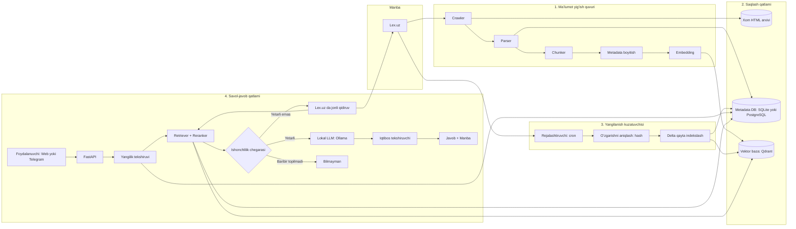
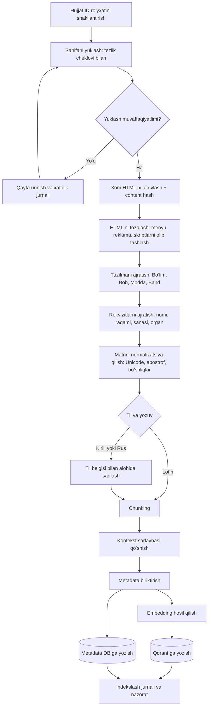
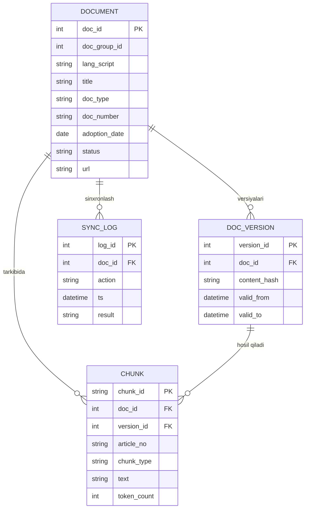
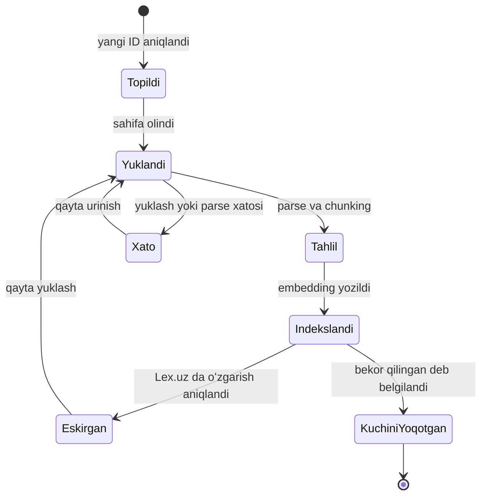
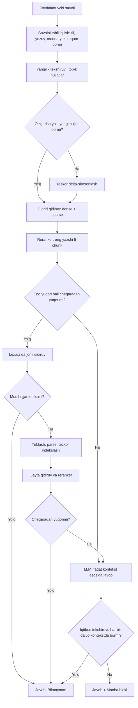
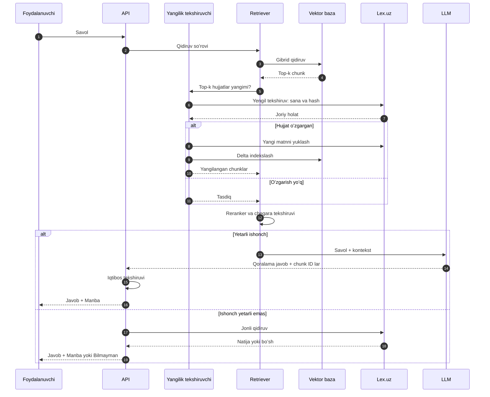
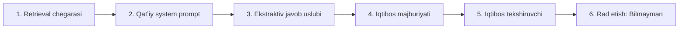
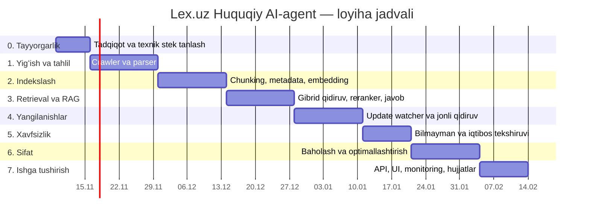
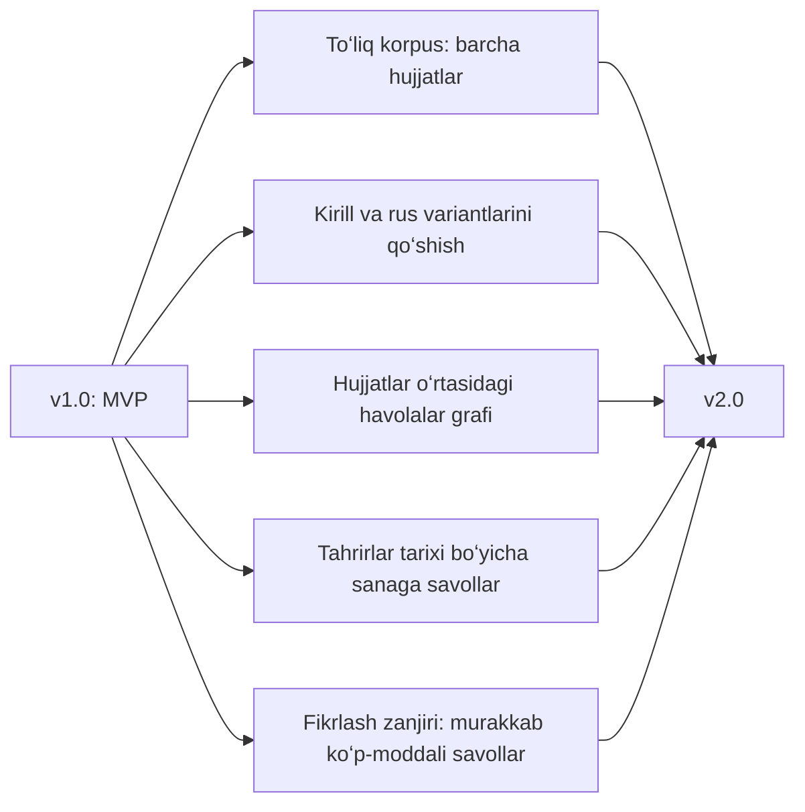

# Lex.uz asosidagi Huquqiy AI-agent — Yoʻl xaritasi

> **Maqsad:** Lex.uz (Oʻzbekiston Respublikasi Qonunchilik maʼlumotlari milliy bazasi) maʼlumotlariga tayanib ishlaydigan, **faqat topilgan manbaga asoslanib** javob beradigan, har bir javobni **aniq manba** bilan yakunlaydigan va topa olmasa **«Bilmayman»** deydigan huquqiy sunʼiy intellekt agentini **toʻliq lokal va bepul** vositalarda yaratish.

---

## Mundarija

1. [Loyiha talablari](#1-loyiha-talablari)
2. [Lex.uz haqida muhim texnik haqiqatlar](#2-lexuz-haqida-muhim-texnik-haqiqatlar)
3. [Umumiy arxitektura](#3-umumiy-arxitektura)
4. [Texnologiyalar steki (bepul va lokal)](#4-texnologiyalar-steki-bepul-va-lokal)
5. [Maʼlumotlarni qayta ishlash quvuri (Ingestion)](#5-maʼlumotlarni-qayta-ishlash-quvuri-ingestion)
6. [Yangilanishlarni kuzatish (Update RAG)](#6-yangilanishlarni-kuzatish-update-rag)
7. [Savolga javob berish oqimi](#7-savolga-javob-berish-oqimi)
8. [Gallyutsinatsiyadan himoya qatlamlari](#8-gallyutsinatsiyadan-himoya-qatlamlari)
9. [Bosqichma-bosqich yoʻl xaritasi](#9-bosqichma-bosqich-yoʻl-xaritasi)
10. [Baholash va sifat mezonlari](#10-baholash-va-sifat-mezonlari)
11. [Loyiha papka tuzilmasi](#11-loyiha-papka-tuzilmasi)
12. [Xavflar va ularni kamaytirish](#12-xavflar-va-ularni-kamaytirish)
13. [Huquqiy va etik eslatmalar](#13-huquqiy-va-etik-eslatmalar)
14. [Birinchi qadamlar](#14-birinchi-qadamlar)

---

## 1. Loyiha talablari

| № | Talab | Texnik ifodasi |
|---|-------|----------------|
| 1 | Lex.uz maʼlumotlarini oʻqish | Crawler + HTML parser |
| 2 | Tuzilmasiz matnni tartibga solish | Tuzilmaga asoslangan chunking (modda boʻyicha) + overlap |
| 3 | Metadata biriktirish | Hujjat turi, raqami, sanasi, moddasi, holati, URL va h.k. |
| 4 | Embedding qilib vektor bazaga saqlash | Koʻp tilli embedding modeli + lokal vektor baza |
| 5 | LLM faqat bilimga tayanib javob berishi | RAG, qatʼiy system prompt, kontekstdan tashqariga chiqmaslik |
| 6 | Savoldan avval yangilanishlarni tekshirish | Update watcher + savol vaqtidagi «yangilik tekshiruvi» |
| 7 | Javob oxirida aniq manba | Majburiy `Manba:` bloki + iqtibos tekshiruvchi |
| 8 | Topilmasa «Bilmayman» | Ishonchlilik chegarasi (threshold) + rad etish qoidasi |
| 9 | Foydalanuvchi soʻrovlari retriever orqali | Gibrid qidiruv (dense + sparse) + reranker |
| 10 | Bepul va lokal ishlash | Ollama, Qdrant/Chroma/pgvector, ochiq manbali modellar |

---

## 2. Lex.uz haqida muhim texnik haqiqatlar

Loyihani boshlashdan oldin quyidagilarni **amalda tekshirib chiqish** kerak (ular ochiq manbalardagi maʼlumotlarga asoslangan, lekin Lex.uz oʻzgarishi mumkin):

- Lex.uz uchun **sitemap va ommaviy (bulk) API yoʻq** deb taʼriflanadi; qidiruv tizimi ASP.NET WebForms asosida ishlaydi. Demak, hujjatlarni topish uchun ID boʻyicha kashf qilish (enumeration) strategiyasi kerak boʻladi.
- Bitta hujjat **har bir til/yozuv uchun alohida ID** bilan saqlanadi: oʻzbek lotin, oʻzbek kirill, rus, ingliz. Ochiq dataset muallifi lotin hujjat ID si kirill ID ning **manfiy qiymati** ekanini taʼkidlaydi — buni oʻzingiz tekshirib tasdiqlang.
- Hujjatlarning taxminan yarmida oʻzbek **lotin** varianti mavjud; qolganlari faqat kirill va/yoki rus tilida. Toʻliq qamrov kerak boʻlsa, kirill variantini ham qayta ishlash kerak.
- Lex.uz uchun **RSS tasmasi** (`https://lex.uz/rss`) mavjudligi uchinchi tomon roʻyxatlarida koʻrsatilgan — **ishlashini tekshiring**; ishlamasa, «Yangi hujjatlar» sahifasini kuzatishga oʻting.
- Tayyor ochiq korpus mavjud: Hugging Face dagi **`sukhrobnurali/uzbek-legal-corpus`** (oʻzbek lotin, moddalar boʻyicha tuzilgan, 1991–2026). Prototip va baholash uchun **boshlangʻich maʼlumot** sifatida ishlatish mumkin, lekin u «jonli baza» emas, qotirilgan nusxa (snapshot).
- Lex.uz ni **Adolat** milliy huquqiy axborot markazi yuritadi (Adliya vazirligi tizimida). Rasmiy matn manbasi — Lex.uz; shuning uchun har bir javobda Lex.uz havolasi boʻlishi shart.

> **Xulosa:** loyihaning eng katta texnik xavfi — LLM emas, balki **Lex.uz dan barqaror va odobli tarzda maʼlumot olish** hamda **oʻzbek tilidagi sifat**.

---

## 3. Umumiy arxitektura



**Asosiy gʻoya:** tizim ikki yoʻl bilan ishlaydi — (a) **oldindan** indekslash (offline), (b) **savol vaqtida** yangilik tekshiruvi va kerak boʻlsa jonli qidiruv (online).

---

## 4. Texnologiyalar steki (bepul va lokal)

| Qatlam | Asosiy tanlov | Muqobil | Izoh |
|--------|---------------|---------|------|
| Dasturlash tili | Python 3.11+ | — | Barcha kutubxonalar mavjud |
| HTTP/Crawler | `httpx` + `tenacity` (qayta urinish) | `requests`, `scrapy` | Tezlikni cheklash va keshlash majburiy |
| JS kerak boʻlsa | Playwright | Selenium | Faqat HTML yetmasa ishlating |
| HTML parser | `selectolax` yoki `BeautifulSoup4` | `lxml` | Lex.uz tuzilmasiga moslab yoziladi |
| Embedding | `BAAI/bge-m3` | `intfloat/multilingual-e5-large` | Koʻp tilli, uzun matn va dense+sparse imkoniyati |
| Reranker | `BAAI/bge-reranker-v2-m3` | Cross-encoder | Aniqlikni sezilarli oshiradi |
| Vektor baza | **Qdrant** (Docker, lokal) | Chroma, **pgvector** | Qdrant payload filtr va gibrid qidiruvni qoʻllaydi |
| Metadata/holat DB | SQLite (MVP) → PostgreSQL | — | Hujjat versiyalari va sinxronlash jurnali |
| Leksik qidiruv | Qdrant sparse yoki SQLite FTS5 / `rank_bm25` | OpenSearch | Modda raqami, hujjat raqami uchun juda muhim |
| LLM | **Ollama** orqali ochiq model (masalan, Qwen2.5, Llama 3.1, Gemma 2) | llama.cpp, vLLM | Qurilmaga qarab 3B–9B tanlang |
| Orkestratsiya | Oddiy Python + `LlamaIndex` (ixtiyoriy) | LangChain | Murakkab freymvorkdan qochish — nazorat osonroq |
| API | FastAPI | — | `/ask`, `/health`, `/sync` |
| Rejalashtirish | APScheduler yoki `cron` | Celery + Redis | MVP uchun APScheduler yetarli |
| Baholash | Oʻz «oltin toʻplam»i + `ragas` | — | 100–200 savol-javob juftligi |
| Kuzatuv | Python `logging` + Langfuse (self-host) | Prometheus | Har bir javobning izini saqlash |
| Joylashtirish | `docker-compose` | — | Qdrant, API, Ollama bir joyda |

> **Qurilma tavsiyasi:** kamida 16 GB RAM; 7–9B modellar uchun 8 GB+ VRAM-li GPU qulay. GPU boʻlmasa, 3–4B model va kvantlashtirilgan (Q4) variantlardan foydalaning.

> **Muhim ogohlantirish:** kichik ochiq modellarning **oʻzbek tilidagi** sifati ingliz tilidagiga qaraganda past boʻlishi mumkin. Shuning uchun javob **topilgan modda matniga yaqin (ekstraktiv)** shaklda tuziladi, erkin ijodga yoʻl qoʻyilmaydi (8-boʻlimga qarang).

---

## 5. Maʼlumotlarni qayta ishlash quvuri (Ingestion)

### 5.1. Oqim sxemasi



### 5.2. Chunking strategiyasi (huquqiy matn uchun)

Oddiy «har 500 belgida kes» usuli **huquqiy matn uchun yaroqsiz** — modda ma’nosi buziladi. Tavsiya etiladigan yondashuv:

1. **Birinchi daraja — tuzilma boʻyicha:** bitta **modda** = bitta asosiy chunk.
2. **Ikkinchi daraja — uzun moddalar:** agar modda belgilangan hajmdan (taxminan 400–600 token) oshsa, **band/qism** boʻyicha boʻlinadi.
3. **Overlap:** faqat uzun moddalarni boʻlganda, qoʻshni boʻlaklar orasida **10–15 %** ustma-ust tushish qoldiriladi.
4. **Kontekst sarlavhasi (contextual header):** har bir chunk boshiga qisqa sarlavha qoʻshiladi, masalan:
   `[Hujjat nomi | Turi | Raqami | Sanasi | Boʻlim > Bob > Modda]`
   Bu embedding sifatini va iqtibosni sezilarli yaxshilaydi.
5. **Ota-bola (parent-child) qidiruv:** kichik chunk bilan qidiriladi, LLM ga esa uning **toʻliq moddasi** (ota-chunk) beriladi.
6. **Jadval va ilovalar:** alohida chunk turi (`chunk_type = table | annex`) sifatida saqlanadi.
7. **Atamalar lugʻati:** «Asosiy tushunchalar» moddalari alohida belgilanadi (`is_definition = true`).

### 5.3. Metadata sxemasi

| Maydon | Turi | Misol/Izoh |
|--------|------|-----------|
| `chunk_id` | string | `doc123#m45#p2` |
| `doc_id` | int | Lex.uz hujjat ID si |
| `doc_group_id` | int | Bir hujjatning turli til versiyalarini bogʻlaydi |
| `lang_script` | enum | `uz-lat`, `uz-cyr`, `ru`, `en` |
| `title` | string | Hujjat nomi |
| `doc_type` | enum | Konstitutsiya, Kodeks, Qonun, Farmon, Qaror, Buyruq va h.k. |
| `doc_number` | string | Hujjat raqami |
| `adoption_date` | date | Qabul qilingan sana |
| `effective_date` | date | Kuchga kirgan sana |
| `issuing_body` | string | Qabul qilgan organ |
| `status` | enum | `active`, `amended`, `repealed` |
| `hierarchy_path` | string | Boʻlim > Bob > Modda |
| `article_no` | string | Modda raqami |
| `chunk_type` | enum | `article`, `part`, `table`, `annex`, `definition` |
| `url` | string | Aniq Lex.uz havolasi |
| `content_hash` | string | Oʻzgarishni aniqlash uchun |
| `fetched_at` | datetime | Oxirgi yuklangan vaqt |
| `valid_from` / `valid_to` | datetime | Versiya amal qilish davri |

### 5.4. Maʼlumotlar modeli



> **Eslatma:** vektorlar Qdrant da saqlanadi; yuqoridagi jadvallar esa **holat va versiya nazorati** uchun metadata bazasida turadi. Qdrant payload ida ham asosiy filtr maydonlari (`status`, `doc_type`, `lang_script`, `article_no`) takrorlanadi.

---

## 6. Yangilanishlarni kuzatish (Update RAG)

Talab: *«Tizim javob berishdan oldin Lex.uz da yangilanish bor-yoʻqligini tekshirishi kerak.»* Buni **uch qatlamli** kuzatuv bilan hal qilamiz:

| Qatlam | Qachon ishlaydi | Nima qiladi | Narxi |
|--------|-----------------|-------------|-------|
| **A. Davriy kuzatuvchi** | Har 1–6 soatda (cron) | RSS yoki «Yangi hujjatlar» sahifasidan yangi/oʻzgargan ID larni oladi | Past |
| **B. Aylanma tekshiruv** | Kechasi, navbat bilan | Indekslangan hujjatlarning hash ini qayta hisoblab solishtiradi | Oʻrta |
| **C. Savol vaqtidagi tekshiruv** | Har bir savolda | Retriever topgan **top-k hujjat** sahifasini yengil tekshiradi (sarlavha, sana, hash) | Past (faqat top-k) |

### 6.1. Hujjat hayot sikli



### 6.2. Delta-yangilash qoidalari

1. Hujjat oʻzgarganini **`content_hash`** farqi bilan aniqlang.
2. Faqat **oʻzgargan moddalarni** qayta embedding qiling (modda darajasidagi hash).
3. Eski chunklarni **oʻchirmang** — `valid_to` qoʻyib, `status = amended` deb belgilang (tarixni saqlash uchun).
4. Standart qidiruvda faqat `status = active` filtrdan oʻtkaziladi.
5. Har bir sinxronlash `SYNC_LOG` ga yoziladi (nima, qachon, natija).

---

## 7. Savolga javob berish oqimi

### 7.1. Qaror daraxti



### 7.2. Ketma-ketlik diagrammasi



### 7.3. Javob formati (majburiy shablon)

```
<Javob matni — faqat topilgan moddalarga asoslangan>

Manba:
• <Hujjat nomi>, <turi> № <raqami>, <sanasi>, <modda/band raqami>
  https://lex.uz/docs/<ID>
```

Agar topilmasa, **aynan** quyidagicha javob beriladi:

```
Bilmayman. Lex.uz dagi mavjud maʼlumotlar asosida bu savolga ishonchli javob topa olmadim.
```

---

## 8. Gallyutsinatsiyadan himoya qatlamlari



| № | Qatlam | Qanday ishlaydi |
|---|--------|-----------------|
| 1 | **Retrieval chegarasi** | Reranker bali belgilangan chegaradan past boʻlsa, LLM umuman chaqirilmaydi |
| 2 | **System prompt** | «Faqat berilgan kontekstdan foydalan; oʻz bilimingdan foydalanma» |
| 3 | **Ekstraktiv uslub** | Javob modda matniga yaqin; mumkin qadar toʻgʻridan-toʻgʻri keltirish va sodda izoh |
| 4 | **Iqtibos majburiyati** | LLM har bir da’voga `[chunk_id]` biriktirishi shart |
| 5 | **Tekshiruvchi** | Dasturiy: javobdagi barcha `chunk_id` kontekstda bormi; raqamlar, sanalar, modda raqamlari kontekst bilan mos keladimi |
| 6 | **Rad etish** | Tekshiruv muvaffaqiyatsiz boʻlsa — «Bilmayman» |

**System prompt namunasi (oʻzbekcha):**

```
Sen Oʻzbekiston qonunchiligi boʻyicha yordamchisan.
QOIDALAR:
1. Faqat quyida berilgan KONTEKST asosida javob ber. Oʻz bilimingdan foydalanma.
2. Har bir fikr oxiriga tegishli manba belgisini qoʻy: [chunk_id].
3. Kontekstda javob yoʻq yoki yetarli emas boʻlsa, faqat shuni yoz: "Bilmayman."
4. Modda raqami, sana va hujjat raqamini oʻzgartirma, taxmin qilma.
5. Javob oxirida "Manba:" blokini yoz.
6. Bu rasmiy yuridik maslahat emasligini unutma; murakkab holatlarda mutaxassisga murojaat qilishni tavsiya qil.

KONTEKST:
{context}

SAVOL:
{question}
```

---

## 9. Bosqichma-bosqich yoʻl xaritasi

### 9.1. Vaqt jadvali (taxminan 14 hafta)



### 9.2. Bosqichlar mazmuni

#### 0-bosqich — Tayyorgarlik va tadqiqot (1 hafta)

- [ ] Lex.uz sahifa tuzilmasini qoʻlda oʻrganish (hujjat sahifasi, modda belgilari, til variantlari)
- [ ] `robots.txt`, foydalanish shartlarini tekshirish; zarur boʻlsa, Adolat markaziga rasmiy murojaat rejasi
- [ ] RSS (`/rss`) va «Yangi hujjatlar» sahifasini sinash
- [ ] Hugging Face dagi ochiq korpusni yuklab koʻrish (prototip uchun)
- [ ] Qurilmada LLM va embedding modellarini sinash (tezlik, xotira)
- [ ] **MVP qamrovini belgilash:** Konstitutsiya + asosiy kodekslar + eng koʻp soʻraladigan qonunlar (bir necha yuz hujjat)

**Natija:** texnik qaror hujjati (ADR), ishlaydigan lokal muhit.
**Tayyorlik mezoni:** 10 ta hujjatni qoʻlda yuklab, parse qilish mumkinligi isbotlangan.

#### 1-bosqich — Crawler va parser (2 hafta)

- [ ] Tezlik cheklovli (masalan, 1 soʻrov/soniya), keshli, qayta urinishli yuklovchi
- [ ] Hujjat ID larini kashf qilish strategiyasi (RSS + ID diapazoni + qidiruv sahifalari)
- [ ] HTML → tuzilma: sarlavha, rekvizitlar, Boʻlim/Bob/Modda/Band
- [ ] Xom HTML arxivi va `content_hash`
- [ ] Parserga birlik testlari (har xil hujjat turlari uchun)

**Natija:** `data/raw` va `data/parsed` (JSON) papkalari.
**Tayyorlik mezoni:** MVP hujjatlarining ≥ 95 % i xatosiz parse qilinadi.

#### 2-bosqich — Chunking, metadata, embedding (2 hafta)

- [ ] Modda boʻyicha chunker + uzun moddalar uchun overlap
- [ ] Kontekst sarlavhasi qoʻshish
- [ ] Metadata sxemasini joriy etish (5.3-boʻlim)
- [ ] Embedding modeli bilan vektorlash, Qdrant kolleksiyasini yaratish
- [ ] Metadata DB (hujjat, versiya, sinxronlash jurnali)

**Natija:** MVP korpusi toʻliq indekslangan.
**Tayyorlik mezoni:** «Modda raqami boʻyicha» va «mavzu boʻyicha» qidiruv sinov soʻrovlarida mantiqiy natija beradi.

#### 3-bosqich — Retrieval va asosiy RAG (2 hafta)

- [ ] Gibrid qidiruv (dense + sparse) va metadata filtrlari
- [ ] Reranker qoʻshish
- [ ] Ota-bola chunk mantiqi
- [ ] LLM bilan javob generatsiyasi, system prompt
- [ ] `Manba:` blokini avtomatik shakllantirish

**Natija:** ishlaydigan «baseline» savol-javob.
**Tayyorlik mezoni:** oltin toʻplamda Recall@5 koʻrsatkichi belgilangan minimal darajadan yuqori.

#### 4-bosqich — Yangilanishlarni kuzatish (2 hafta)

- [ ] Davriy kuzatuvchi (A qatlami)
- [ ] Aylanma hash tekshiruvi (B qatlami)
- [ ] Savol vaqtidagi tezkor tekshiruv (C qatlami)
- [ ] Delta-indekslash va versiyalash (`valid_from`, `valid_to`)
- [ ] Jonli qidiruv moduli (indeksda yoʻq hujjatlar uchun)

**Natija:** yangi qabul qilingan hujjat/oʻzgarish tizimda belgilangan muddatda paydo boʻladi.
**Tayyorlik mezoni:** sinov uchun tanlangan oʻzgarish 24 soat ichida (yoki belgilangan SLA ichida) indeksga kiradi.

#### 5-bosqich — «Bilmayman» va iqtibos tekshiruvi (1,5 hafta)

- [ ] Ishonchlilik chegarasini maʼlumotlar asosida kalibrlash
- [ ] Iqtibos tekshiruvchi (chunk ID, raqam, sana mosligi)
- [ ] Rad etish senariylari uchun test toʻplami (korpusda yoʻq savollar)
- [ ] Prompt-injection himoyasi: hujjat ichidagi «buyruq»larga LLM boʻysunmasligi

**Natija:** korpusda javobi yoʻq savollarga barqaror «Bilmayman».
**Tayyorlik mezoni:** rad etish testlarida yolgʻon javob ulushi minimal (maqsad: 0 ga yaqin).

#### 6-bosqich — Baholash va optimallashtirish (2 hafta)

- [ ] 100–200 savoldan iborat oʻzbekcha oltin toʻplam (huquqshunos bilan birga tekshirilgani maʼqul)
- [ ] Metrikalarni oʻlchash (10-boʻlim)
- [ ] Chunk oʻlchami, overlap, top-k, chegaralarni sozlash
- [ ] Model taqqoslash (LLM va embedding)
- [ ] Kechikish (latency) optimallashtirish: kesh, batch, kvantlash

**Natija:** baholash hisoboti va sozlangan konfiguratsiya.

#### 7-bosqich — Ishga tushirish (1,5 hafta)

- [ ] FastAPI endpointlari, oddiy veb-interfeys yoki Telegram bot
- [ ] `docker-compose` bilan bir buyruqda ishga tushirish
- [ ] Monitoring, jurnal, xatolik ogohlantirishlari
- [ ] Foydalanuvchi uchun «yuridik maslahat emas» ogohlantirishi
- [ ] Hujjatlashtirish (README, arxitektura, ekspluatatsiya qoʻllanmasi)

**Natija:** barqaror lokal versiya (v1.0).

### 9.3. Keyingi bosqichlar (v2 gʻoyalari)



---

## 10. Baholash va sifat mezonlari

| Soha | Metrika | Izoh |
|------|---------|------|
| Retrieval | Recall@k, MRR, nDCG | Toʻgʻri modda top-k ga kirdimi |
| Javob sifati | Faithfulness (kontekstga sodiqlik) | Javobdagi har bir da’vo kontekstda bormi |
| Iqtibos | Citation accuracy | Koʻrsatilgan manba haqiqatan javobni tasdiqlaydimi |
| Rad etish | Refusal precision/recall | Javob yoʻq savolga «Bilmayman» deyish; javob bor savolga ortiqcha rad etmaslik |
| Yangilik | Freshness lag | Lex.uz dagi oʻzgarish va indeks oʻrtasidagi kechikish |
| Tezlik | P50/P95 latency | Savoldan javobgacha vaqt |
| Barqarorlik | Parse muvaffaqiyat ulushi | Xatosiz qayta ishlangan hujjatlar foizi |

**Oltin toʻplam toifalari:** (1) aniq modda soʻrovi, (2) mavzuviy savol, (3) koʻp moddali savol, (4) yangilangan hujjat haqida savol, (5) korpusda **yoʻq** savol (rad etish testi), (6) qarama-qarshi yoki chalgʻituvchi savol.

---

## 11. Loyiha papka tuzilmasi

```
lexuz-legal-ai/
├── docker-compose.yml
├── pyproject.toml
├── README.md
├── configs/
│   ├── settings.yaml            # chegaralar, model nomlari, tezlik cheklovi
│   └── prompts/
│       └── system_uz.txt
├── data/
│   ├── raw/                     # xom HTML arxivi
│   ├── parsed/                  # tuzilmaviy JSON
│   └── eval/                    # oltin savol-javoblar
├── src/
│   ├── crawler/                 # yuklash, ID kashfi, tezlik cheklovi
│   ├── parser/                  # HTML → tuzilma
│   ├── chunking/                # modda boʻyicha chunker
│   ├── embedding/               # embedding va reranker
│   ├── store/                   # Qdrant, metadata DB
│   ├── updater/                 # kuzatuvchi, hash, delta
│   ├── retrieval/               # gibrid qidiruv, ota-bola
│   ├── generation/              # prompt, LLM chaqiruvi
│   ├── guard/                   # chegara, iqtibos tekshiruvchi, rad etish
│   └── api/                     # FastAPI
├── tests/
└── scripts/
    ├── bootstrap_index.py
    ├── sync_updates.py
    └── run_eval.py
```

---

## 12. Xavflar va ularni kamaytirish

| Xavf | Taʼsir | Kamaytirish choralari |
|------|--------|-----------------------|
| Lex.uz tuzilmasi oʻzgaradi | Parser buziladi | Parser testlari, xom HTML arxivi, monitoring |
| Yuklash cheklanadi yoki bloklanadi | Maʼlumot yangilanmaydi | Odob bilan crawl, keshlash, rasmiy hamkorlik |
| Oʻzbek tilida LLM sifati past | Notoʻgʻri talqin | Ekstraktiv javob, kuchliroq model, reranker, rad etish |
| Embedding oʻzbek lotin/kirill farqida chalkashadi | Qidiruv sifati pasayadi | Yozuvni normalizatsiya qilish, lang_script filtri, koʻp tilli model |
| Eskirgan norma bilan javob | Yuridik xato | Uch qatlamli yangilik tekshiruvi, `status` filtri |
| Qurilma quvvati yetmaydi | Sekin ishlash | Kichik model, kvantlash, kesh, GPU boʻlmasa asinxron navbat |
| Gallyutsinatsiya | Ishonchni yoʻqotish | 8-boʻlimdagi 6 qatlamli himoya |
| Prompt-injection (hujjat ichidagi matn orqali) | Xavfsizlik | Kontekstni «maʼlumot» deb belgilash, buyruqlarga boʻysunmaslik qoidasi |
| Foydalanuvchi javobni rasmiy maslahat deb oladi | Mas’uliyat | Doimiy ogohlantirish matni |

---

## 13. Huquqiy va etik eslatmalar

- Tizim **yuridik maslahat bermaydi**; u faqat qonunchilik matnini topib, tushuntirib beruvchi **axborot vositasi**. Har bir javobda buni qisqa eslatma sifatida koʻrsatish tavsiya etiladi.
- Lex.uz dan maʼlumot olishda **foydalanish shartlari, `robots.txt` va tezlik cheklovlariga** rioya qiling; serverga ortiqcha yuk tushirmang. Katta hajmli yigʻish oldidan **rasmiy ruxsat/hamkorlik** masalasini aniqlashtirish maqsadga muvofiq.
- Rasmiy va kuchga ega matn — **Lex.uz dagi hujjat**. Agentning javobi uning talqini ekanini aniq bildiring va doimo asl havolani bering.
- Foydalanuvchi savollarida shaxsiy maʼlumotlar boʻlishi mumkin: jurnallarda ularni maskalang yoki saqlamang.

---

## 14. Birinchi qadamlar

1. **Bu hafta:** 0-bosqichni boshlang — Lex.uz da 10 ta hujjatni (jumladan Konstitutsiya va bitta kodeks) qoʻlda tahlil qilib, HTML tuzilmasini yozib oling.
2. **Parallel:** Ollama oʻrnating va bitta 7B hamda bitta 3–4B modelni oʻzbekcha savollar bilan sinab koʻring.
3. **Prototip:** ochiq `uzbek-legal-corpus` ni Qdrant ga yuklab, 3-bosqichdagi «baseline» RAG ni **parserdan oldin** ishlatib koʻring — bu retrieval va prompt gʻoyalarini tez tekshirish imkonini beradi.
4. **Qaror nuqtasi:** 0-bosqich oxirida MVP qamrovi, model va vektor baza tanlovini yakunlang.

---

*Hujjat versiyasi: 1.0 · Sana: 2026-11-02 · Til: oʻzbek (lotin)*
